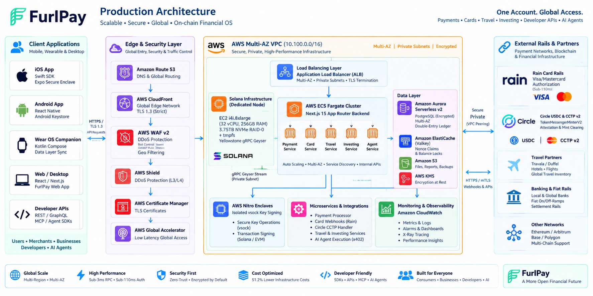
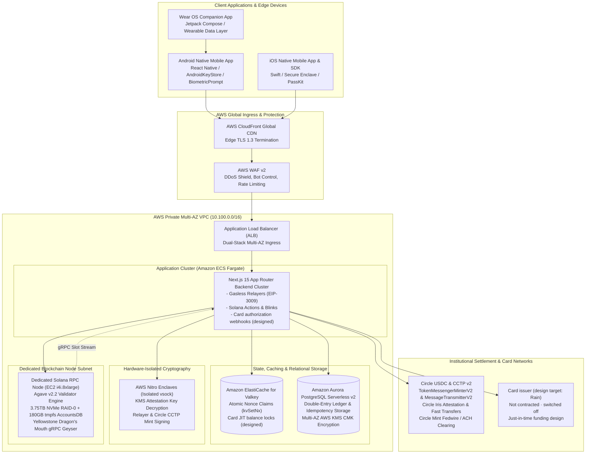
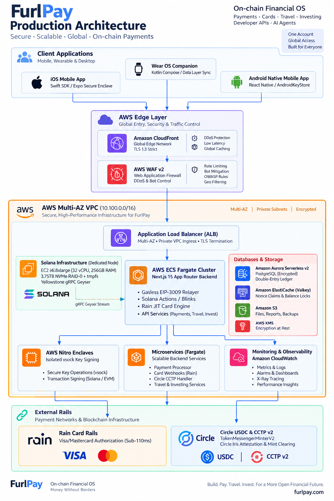

# FurlPay Documentation & Architecture Blueprints

### Digital-Dollar Payment Infrastructure: Documentation & Blueprints

Enterprise-grade technical documentation, AWS cloud migration roadmaps, dedicated Agave v2.x Solana RPC specifications, Circle CCTP v2 cross-chain rails, Rain JIT virtual-card rail blueprints, and internal security reviews. Documents marked **Blueprint** or **Plan** describe the target architecture, not what runs today.

---

## Current status (15 October 2026)

| Area | Today | Plan |
| :--- | :--- | :--- |
| **Web app and API** | Next.js 15 on **Vercel** (446 route handlers, 269 pages), serving [furlpay.com](https://furlpay.com) | ECS Fargate behind CloudFront ([runbook](deploy/WEB-AWS.md)) |
| **Database** | **Supabase Postgres**, reached through PostgREST over HTTP | Aurora PostgreSQL is not a drop-in replacement; see the [engagement brief](aws/AWS-ENGAGEMENT-BRIEF.md) |
| **Key-value store** | **Upstash Redis** (REST), which holds passkeys, API keys and OAuth clients | Needs a durable AWS design; ElastiCache speaks TCP, not REST |
| **AI features** | Claude Haiku 4.5 through the Anthropic API | Evaluating Amazon Bedrock |
| **AWS** | Account set up; **no production workloads**. Active relationship with AWS Startups BD (from TOKEN2049 Singapore, Oct 2026). | Migration planned, not started. Activate credits discussion active; see [TOKEN2049 engagement log](aws/TOKEN2049-AWS-ENGAGEMENT-LOG.md). |
| **Card issuing** | **Designed, switched off.** No card issuer is contracted | Issuer selection pending |
| **Banking, on-ramp and off-ramp** | Switched off; no provider contracted | Partner selection pending |
| **iOS app** | Blocked on an Apple Developer account | [iOS runbook](deploy/IOS-RELEASE.md) |
| **Security audits** | Reports under `audit/` are **internal reviews**; no third-party audit yet | — |

What FurlPay can state publicly, and with which qualifiers, is governed by the [verified-claims register](docs/VERIFIED-CLAIMS.md). If a claim is not in its green table, it does not go in an email, a deck or a grant application.

---

## Target Architecture (AWS migration blueprint)

The diagrams below show the **planned** AWS architecture. None of it is deployed yet.

*Figure 1: Target AWS architecture (planned, not deployed): multi-AZ private VPC, dedicated Solana RPC nodes, ECS Fargate Next.js 15 backend, Nitro Enclave key isolation and settlement rails.*

*Figure 2: Stablecoin payment rails, hardware key signing and the designed card-authorization path (design; card issuing is not live).*

---

## Master Documentation Index

### 0. Deployment & Environments (deploy/)

Operational runbooks for shipping each surface, and the environment contract
they all share. Start here if you are moving the platform onto AWS.

* [Environments — development, staging, production](deploy/ENVIRONMENTS.md)  
  What an environment *is* in this codebase: the `FURLPAY_ENV` financial-mode
  switch, the Vercel-injected variables that stop existing on AWS (including
  the one that silently breaks passkeys), the five scheduled jobs, and the
  managed-service decisions the migration forces.

* [AWS Security Baseline](deploy/AWS-SECURITY-BASELINE.md)  
  The controls that gate a go-live: multi-account topology with SCP
  boundaries, IAM Identity Center with no IAM users, Secrets Manager, KMS and
  Nitro Enclave key custody, detection, supply chain, and a go-live checklist.

* [Web — Vercel → AWS](deploy/WEB-AWS.md)  
  ECS Fargate behind CloudFront for the app (446 route handlers and 269 pages
  on 15 October 2026; 314 and 219 when written); why not
  Amplify, Lambda or App Runner; EventBridge for the crons; the cutover and
  rollback plan.

* [Android Release Runbook](docs/ANDROID-RELEASE.md) · [Play Store Signing](docs/PLAY-SIGNING-RUNBOOK.md)  
  EAS builds, keystore custody, and the Play App Signing step.

* [iOS Release Runbook](deploy/IOS-RELEASE.md)  
  Currently blocked on an Apple Developer account. Covers the SDK floor, the
  watchOS and widget targets, and what App Store review asks a financial app.

* [Wear OS Release Runbook](deploy/WEAR-OS-RELEASE.md)  
  Why the watch app shares the phone's `applicationId`, same-key signing, and
  the fingerprint registration that passkeys depend on.

---

### 1. Engineering Blog & Technical Articles (blog/)

* [Scaling Stablecoin Payments to Millions: Why FurlPay Is Moving from Shared RPCs to Dedicated AWS Infrastructure](blog/scaling-stablecoin-payments-to-millions-aws.md)  
  Architecture post on the target design: Visa/Allium real-economy stablecoin data, Singapore's clearing hub, dedicated Agave Solana RPC nodes on EC2 `i4i.8xlarge`, a designed card-authorization path, Circle CCTP v2 burn-and-mint and a modeled 51.2% cost reduction. **The migration has not started**; latency and cost figures are targets.

---

### 2. AWS Cloud & Dedicated Infrastructure Blueprints (aws/)

Everything in this section is a **blueprint**: planned, not deployed.

* [AWS Engagement Brief: current state, pain points and asks](aws/AWS-ENGAGEMENT-BRIEF.md)  
  Where FurlPay runs today, the nine problems the migration has to solve, and what we are asking AWS for. Start here if you are from AWS.
* [Virtual Card JIT Rails Plan](docs/VIRTUAL-CARD-JIT-RAILS-PLAN.md)  
  How FurlPay virtual cards will work with Rain: real-time authorization against the user's USDC balance, atomic holds, clearing and reversals, funding and daily reconciliation, travel-card merchant locks, failure handling, the AWS layout and a phased rollout. **Plan; no issuer contracted yet.**

* [Cross-Platform USDC Payment Engine & AWS Architecture (2026–2027)](aws/FURLPAY_USDC_PAYMENT_FLOW_AND_AWS_ARCHITECTURE.md)  
  End-to-end USDC payment flow across Android Native (`native-app`), Wear OS (`guardian`), iOS (`furlpay-swift`), and AWS dedicated infrastructure. Covers hardware Keystore/Secure Enclave signing, EIP-3009 gasless transfers, Solana v0 transactions, a designed card-authorization path, Circle CCTP v2 burn-and-mint and AWS Nitro Enclaves.
* [1-Year Master Infrastructure & AWS Migration Blueprint (2026–2027)](aws/FURLPAY_1_YEAR_AWS_INFRASTRUCTURE_REPORT.md)  
  Complete 12-month engineering roadmap moving FurlPay from Vercel edge functions and managed RPC providers (Helius/QuickNode) to a private Multi-AZ VPC on Amazon Web Services (AWS).
* [AWS Infrastructure Cost Model & FinOps Report](aws/FURLPAY_AWS_COST_OPTIMIZATION_REPORT.md)  
  Modeled cost of the planned architecture, cut from **$44,040/year** to **$21,480/year (51.2%)** by replacing `io2` Block Express IOPS with local Nitro NVMe SSDs (`i4i.8xlarge`), adopting ElastiCache for Valkey and optimizing standby RPC failover. These model a future bill; FurlPay has not incurred this spend.
* [Credits Funding Plan & Solana Node Specification](aws/FURLPAY_AWS_FREE_TIER_NODE_CONFIG_REPORT.md)  
  A plan to fund the planned infrastructure with AWS Activate credits and Solana Foundation grants; those credits and grants have **not** been secured. Contains official Agave v2.2 validator arguments, Linux sysctl tuning (`21-agave-validator.conf`), dual NVMe RAID-0 storage scripts, tmpfs AccountsDB setup, Yellowstone Dragon's Mouth gRPC configuration, and automated slot health monitoring.
* [AWS Enterprise Security, Compliance & Infrastructure Blueprint (2026–2027)](aws/FURLPAY_AWS_ENTERPRISE_SECURITY_AND_COMPLIANCE_BLUEPRINT.md)  
  Advanced defense-in-depth architecture covering AWS Organizations multi-account governance, KMS envelope encryption with Nitro Enclave PCR attestation, production Terraform IaC modules (VPC, ECS Fargate, WAF v2), a control mapping towards PCI DSS v4.0 and SOC 2 Type II (FurlPay holds neither certification), multi-region disaster recovery runbooks, and SRE alerting matrices.
* [TOKEN2049 AWS Engagement Log](aws/TOKEN2049-AWS-ENGAGEMENT-LOG.md)  
  Timeline of the AWS Startups relationship established at TOKEN2049 Singapore (October 2026), Activate credits discussion status, competitor comparable analysis, and call-preparation notes.

---

### 3. Security Reviews & Vulnerability Assessments (audit/)

These are **internal** reviews. FurlPay has not had a third-party security audit.

* [Monorepo Security Review (internal)](audit/FULL_CODEBASE_AUDIT_REPORT.md)  
  Internal code review across Solana Anchor programs, Next.js API routes, Android/Wear OS native applications, and client SDKs. Uncovers and remediates critical vulnerabilities including the Solana escrow token drain in `auto_release.rs`, merchant wallet fallback to `1111...1111`, WooCommerce/Magento HMAC bypass, Swift timing side-channel leaks, and Android SQLite encryption.
* [Mobile Security Audit & Hardening Guide](docs/MOBILE_SECURITY_AUDIT.md)  
  Analysis of Android and iOS cryptographic boundaries, reverse engineering protections, anti-hooking checks, and biometric authentication gates.
* [x402 Micropayment Attack Vectors & Mitigation](docs/security/x402-attacks.md)  
  Facilitator-layer hardening for HTTP 402 AI agent payment rails, closing cross-resource substitution (F1) and duplicate settlement race conditions (F2).
* [Transaction Security Standards](docs/TRANSACTION_SECURITY.md)  
  The unified authorization boundary: transaction simulation and app attestation built as one control, implemented end to end and covered by 148 tests.

---

### 4. Mobile, Wearable & Client Protocols (docs/)

* [Self-Custodial Wallet Architecture](docs/SELF-CUSTODIAL-WALLET-DESIGN.md)  
  BIP-39, SLIP-0010 (Solana Ed25519), and BIP-44 (EVM Secp256k1) key generation, memory zeroization, and multi-account derivation.
* [Android Native Release & Signing Runbook](docs/ANDROID-RELEASE.md)  
  Google Play Console signing keys, APK optimization, and ProGuard/R8 obfuscation rules.
* [Google Play Store Signing Runbook](docs/PLAY-SIGNING-RUNBOOK.md)  
  Step-by-step key registration, upload keystores, and app integrity verification.
* [Certificate Pinning & Rotation Runbook](docs/CERT-PIN-ROTATION.md)  
  Zero-downtime HPKP / mTLS certificate rotation for mobile network security configs.
* [Hardware Wallet Research](docs/HARDWARE-WALLET-RESEARCH.md)  
  Engineering research on Tangem, Ledger and NFC hardware-token signing. Hardware wallet support is not live.

---

### 5. Protocols, Settlement & Custody Models (docs/)

* [Production Go-Live Money Runbook](docs/GO-LIVE-MONEY.md)  
  Financial operation guidelines, liquidity provisioning, and treasury hot/warm/cold balance thresholds.
* [Ledger Reconciliation & Invariant Checks](docs/RECONCILIATION.md)  
  Continuous double-entry verification between off-chain balances and on-chain token states.
* [Balance Custody Mapping](docs/BALANCE-CUSTODY-MAP.md)  
  Taxonomy of self-custody vs. custodial escrow accounts across multi-chain rails.
* [Custody Disclosure & Regulatory Disclaimers](docs/CUSTODY-DISCLOSURE.md)  
  Compliant disclosure language for retail and institutional stablecoin holders.
* [API v1 Surface Specification](docs/API-V1-SURFACE.md)  
  Public REST & WebSocket interface contracts for merchant integrations.
* [Verified Claims Register](docs/VERIFIED-CLAIMS.md)  
  What FurlPay can say publicly: verifiable claims (green), claims that need a qualifier (amber) and claims not to make (red), each with its evidence.

---

### 6. Expansion Blueprints & Strategy (reports/)

* [Competitor AWS Case Study & Benchmarks](reports/competitor_aws_case_study.md)  
  Deep-dive on the closest AWS Web3 payments case study to FurlPay. Covers $194M funding, $2B valuation, 6M+ users, AWS architecture (ALB → EKS → Aurora), Visa card GTM strategy, regulatory licenses, competitive landscape, and lessons for FurlPay's AWS partnership pitch.
* [Singapore Expansion Master Blueprint](reports/furlpay_singapore_expansion_master_blueprint.md)  
  MAS Major Payment Institution (MPI) compliance roadmap, SGQR / PayNow integration, and Southeast Asian cross-border settlement.
* [USDC Travel Market & Tourism Rails](reports/furlpay_singapore_usdc_travel_market_report.md)  
  Stablecoin travel spend analysis, merchant discount rate (MDR) disruption, and hotel direct-settlement protocols.
* [USDC Travel Architecture & Security Blueprint](reports/furlpay_usdc_travel_architecture_and_security_blueprint.md)  
  Offline travel vouchers, MCC-locked virtual cards, and airline ticketing integration.
* [Algorithmic Settlement & Competitive Disruption](reports/furlpay_algorithmic_settlement_competitive_report.md)  
  Comparative analysis against Stripe, leading crypto-card platforms, and traditional acquiring networks.
* [Partner Onboarding Master Report](reports/furlpay_partner_onboarding_master_report.md)  
  Technical guidelines for payment service providers (PSPs), independent sales organizations (ISOs), and payment gateways.

---

## Technology Stack Breakdown

| Layer | Technologies & Protocols |
| :--- | :--- |
| **Hosting & data (current)** | **Vercel** (Next.js), **Supabase Postgres** via PostgREST, **Upstash Redis** (REST), Anthropic API (Claude Haiku 4.5). |
| **Cloud & Infrastructure (target)** | **Amazon Web Services (AWS)**, planned: EC2 `i4i.8xlarge`, ECS Fargate, CloudFront, ALB, Aurora PostgreSQL Serverless v2, ElastiCache for Valkey, AWS Nitro Enclaves, AWS KMS, Amazon SNS, CloudWatch, Terraform. |
| **Dedicated Blockchain Node (target)** | **Agave v2.2.x** (Solana Validator Engine), **Yellowstone Dragon's Mouth gRPC Geyser**, Ubuntu 24.04 LTS, Nitro NVMe RAID-0, Linux tmpfs AccountsDB. |
| **Cross-Chain & Stablecoins**| **Circle USDC**, **Circle CCTP v2** (`MessageTransmitterV2`, `TokenMessengerMinterV2`), Circle Iris Attestation API, Circle Mint API, Circle Programmable Wallets, Circle Arc. |
| **Card Issuing: Rain JIT rails (plan)** | Rain virtual cards with just-in-time authorization against USDC balances, atomic holds and daily reconciliation ([plan](docs/VIRTUAL-CARD-JIT-RAILS-PLAN.md)). **No issuer is contracted; card issuing is switched off.** |
| **Backend Application** | **Next.js 15 (App Router)**, Node.js 22, TypeScript 5.5, Zod, Viem, `@solana/web3.js`, EIP-3009 Gasless Relay Engine, EIP-712 Typed Signing. |
| **Mobile Applications** | **React Native / Expo** (Android & iOS), **Kotlin 2.1** (Android & Wear OS Compose), **Swift 6.0** (iOS / Apple Watch), Google Play Integrity API, AndroidKeyStore, Apple Secure Enclave. |
| **Security & Cryptography** | Hardware-backed Biometric Authentication (Class 3 / Strong), Ed25519, Secp256k1, AES-256-GCM, Constant-Time HMAC-SHA256, Zeroization. |

---

## Community & Support

- GitHub Organization: [github.com/FurlPay](https://github.com/FurlPay)
- Developer Documentation: [github.com/FurlPay/docs](https://github.com/FurlPay/docs)
- Security Inquiries: [security@furlpay.com](mailto:security@furlpay.com)

---

  Copyright © 2026 FurlPay Inc. All rights reserved. Sovereign financial rails for the next billion users.

