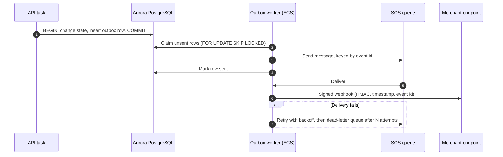

# AWS Data and Event Infrastructure

> **Status, 22 October 2026.** Everything on this page is **PLANNED** unless marked otherwise; no AWS workload is running. The principle is to start with the fewest managed services that keep money correct, and add one only when a measured need appears. **PostgreSQL is the authoritative financial record.** Any other store (cache, queue, analytics, read model) is a projection of it, never a second source of truth.

---

## 1. Decisions at a glance

| Service | Decision | Why |
| :--- | :--- | :--- |
| **Amazon S3** | **Use** | Private document and PDF storage replacing Supabase Storage (implemented in code on a feature branch); access logs; evidence archive. |
| **S3 Object Lock** | **Use** for the evidence and audit-log buckets | Write-once retention for payment evidence and CloudTrail logs. Retention is set from legal advice per jurisdiction. The CloudTrail bucket is already defined with Object Lock in Terraform. |
| **Amazon SQS + dead-letter queues** | **Use** | Outbox dispatch (webhooks, notifications) and retries. A dead-letter queue already catches failed scheduled-job deliveries in Terraform. |
| **Transactional outbox in PostgreSQL** | **Use**; already used by merchant collection | Makes "state changed" and "event will be delivered" one atomic fact (§2). |
| **Amazon CloudWatch** | **Use** | Alarms on the ALB, ECS and database to SNS; application logs; metrics for credit latency and reconciliation defects. |
| **RDS Proxy** | **Defer** | ECS tasks keep small long-lived pools. Adopt it if short-lived workers are added or connection counts approach the cluster limit; `SET` statements pin connections through the proxy. |
| **Amazon DynamoDB** | **Defer** | No access pattern today that PostgreSQL plus a cache cannot serve. If adopted later, only as a read model rebuilt from PostgreSQL. |
| **Amazon Kinesis / Amazon MSK** | **Not needed** | Event volume is far below what needs a streaming platform. SQS covers dispatch; PostgreSQL holds the history. Revisit only if consuming a full Solana transaction stream. |
| **Amazon Athena** | **Defer** | Useful once evidence and logs in S3 need ad hoc queries. Costs nothing until queried. |
| **AWS Global Accelerator** | **Not needed** | CloudFront already provides global edge entry for HTTPS. Global Accelerator suits non-HTTP or static-anycast needs FurlPay does not have. |
| **Self-operated Solana RPC nodes** | **Not now** | See §4. |

---

## 2. Transactional outbox

- The event id is the idempotency key end to end, so a duplicated send is harmless to a receiver that deduplicates.
- **Merchant collection already works this way (IMPLEMENTED):** `merchant_payment_receive` writes the `merchant_payment_outbox` row in the same transaction as the credit. Delivery is signed, at-least-once, with five attempts over roughly seven hours, and every retry carries the same event id. What is **PLANNED** is the same pattern for the other payment paths, with SQS replacing database polling for dispatch.
- A dead-letter queue is a work queue for operators, with an alarm, not a bin.

---

## 3. Caches and the key-value store

Today Upstash Redis holds both caches (rate limits, short-lived challenges) and **records**: passkeys, API keys, OAuth clients and x402 settlement records. A cache must never be the only copy of a credential.

| Data | Target |
| :--- | :--- |
| Passkeys, API keys, OAuth clients, x402 settlement records | PostgreSQL (**PLANNED**), so that they are backed up, recoverable and covered by point-in-time recovery |
| Rate limits, challenges, short-lived locks | ElastiCache (Valkey/Redis) inside the VPC (**PLANNED**). Until then Upstash, which works from ECS unchanged |

Terraform currently defines ElastiCache with the Redis 7.1 engine; the [web runbook](../deploy/WEB-AWS.md) specifies Valkey and two separate clusters, so authentication state cannot be evicted by bulk caching. Reconciling the two is a backlog item.

---

## 4. Managed versus self-operated Solana RPC

| | Managed providers with failover (chosen) | Self-operated RPC nodes on EC2 |
| :--- | :--- | :--- |
| What FurlPay needs | Read finalized transactions and balances for its own addresses; submit transactions | Same |
| Hardware | None | AWS's own guidance for Solana RPC uses r7a-class instances (e.g. `r7a.16xlarge`, 512 GiB) with large, fast storage, per node, plus a second node for failover |
| Operations | Provider's | Client upgrades on Solana's schedule (Agave 4.3.2 was required for Alpenglow), snapshots, monitoring, on-call |
| Failure handling | Ordered failover across providers; each endpoint proves it serves mainnet before use (**IMPLEMENTED**) | Own load balancing and failover |

**Decision:** stay on managed providers. Reconsider self-operated nodes only with a measured need: provider rate limits on FurlPay's actual volume, a data requirement providers cannot meet (for example a full transaction stream), or a cost crossover calculated from real usage. Earlier blueprints in this repository that specify dedicated nodes describe a target that is **not** part of the current plan; see the notes at the top of those documents.

---

## Sources

- AWS: [S3 conditional writes](https://aws.amazon.com/about-aws/whats-new/2024/08/amazon-s3-conditional-writes); [RDS Proxy pinning](https://docs.aws.amazon.com/AmazonRDS/latest/AuroraUserGuide/rds-proxy-pinning.html); [Run Solana nodes on AWS](https://aws.amazon.com/blogs/web3/run-solana-nodes-on-aws/).
- [Solana Alpenglow validator requirements](https://solana.com/upgrades/alpenglow).
