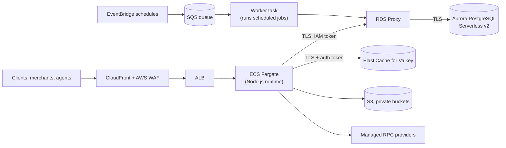

# AWS data plane: implementation status (25 October 2026, updated 26 October)

> **Nothing described here is deployed.** furlpay.com runs on Vercel, Supabase and Upstash. This page records what has been **implemented and tested in the application repository** for the AWS move decided on 22 October 2026, what has **not been verified on AWS**, and what is **blocked**. It supersedes the "in progress" status in the [PostgreSQL migration plan](AWS-POSTGRESQL-MIGRATION.md). Status labels follow the [enterprise architecture](../docs/ENTERPRISE-ARCHITECTURE-2026-2027.md).

## Target, per environment

Region eu-west-1. No self-operated blockchain nodes, no Lightning infrastructure, no Nitro Enclave signing: none of these is part of this migration.

## Status

| Component | Status | Evidence |
|---|---|---|
| PostgreSQL data layer (native `pg` driver) replacing PostgREST | **Implemented, tested locally** | Unit tests; integration tests on a real PostgreSQL server |
| Least-privilege database roles: the application owns nothing, has no exemption from row-level security, and cannot create objects | **Implemented, tested locally** | The full migration chain applied under the AWS role model; the application role is refused CREATE, DROP, TRUNCATE, disabling RLS and adding policies |
| Payments and ledger guarantees under that role model | **Implemented, tested locally** | One payment per (user, idempotency key) enforced by the database; unbalanced and single-legged ledger transactions rejected; a retry cannot double-post; **exactly-once settlement under 10 concurrent attempts** |
| Verified TLS to the database; IAM authentication to RDS Proxy (no database password in the application) | **Implemented, tested locally; not verified on AWS** | Token signing matches the AWS SDK's reference implementation; a connection-string setting that would have dropped certificate verification is now refused |
| Split-brain guard: each database records which platform may use it; a deployment refuses any other | **Implemented, tested locally** | Cutover additionally fences the old database at the database level (see below) |
| ElastiCache for Valkey as the key-value store (TCP + TLS, certificate verification on) | **Implemented; adapter tested; live atomicity not yet tested** | Integration suite against a real Valkey server written, **not yet run** |
| Exactly one key-value store per environment | **Implemented, tested locally** | Configuring both is refused |
| Middleware on the Node.js runtime | **Verified in the production build** | — |
| No server-only module in browser bundles | **Verified** | Build output scan plus a test over every client component's imports |
| Private S3 buckets for onboarding documents and research PDFs | **Implemented, not verified on AWS** | Block Public Access, ACLs disabled, SSE-KMS, TLS-only |
| Scheduled jobs: every current Vercel job has an EventBridge equivalent, delivered as a queue message to a worker service | **Implemented, not verified on AWS; disabled by default** | A tick is removed from the queue only after its job has answered successfully; a crash or failure leaves it to be retried, then dead-lettered with an alarm. Enabled per environment only when Vercel no longer runs the same jobs against that database |
| Merchant-payment outbox: payment, ledger journal and webhook event commit in one transaction | **Implemented, tested on PostgreSQL** | 10 concurrent deliveries of one transfer settle once; concurrent workers never claim the same event; a crashed worker's event is retried after its lease; a stale worker cannot override a newer one (new fencing) |
| Progressive finality for received payments: observed, safe, finalized, or reorganized | **Implemented, tested on PostgreSQL and recorded fixtures** | On rollups a payment is first seen on the sequencer's head; it is marked final only from the chain's own `safe`/`finalized` blocks. A reorganization moves the payment to review and reverses nothing automatically. **Refunds wait for finality** |
| Fee-payer (gas) signing: daily gas budget; AWS KMS secp256k1 signer | **Implemented, tested locally; no key created** | The fee payer holds gas only, never customer funds. Production requires a budget and a key outside the application process |
| Optional chain streams (EVM WebSocket logs, Base Flashblocks, Solana Yellowstone core) | **Implemented as hints, tested on fixtures; off by default** | A streamed transfer only makes the verifier look sooner; nothing is booked from a stream. Needs a provider; Base's public endpoints are HTTP only |
| Hedged read-only RPC requests across managed providers | **Implemented, tested; off by default** | Broadcasts are never hedged |
| Latency metrics (database, key-value, RPC, event loop) and alarms | **Implemented, tested locally** | — |
| Infrastructure as code | **Validated, not applied** | `terraform validate` for every environment; plan-level tests with mocked providers. No plan against real AWS state yet |
| Production | **Not started** | Production keeps the AWS data plane off until its cutover is approved |

## Cutover, in outline

1. Bootstrap the new database and apply every migration under the least-privilege role model.
2. **Fence the source database at the database level**: mark it retired, revoke the application's login and end its sessions. The application's own 30-second re-check is not, by itself, a barrier; the revoke is.
3. Copy the data, reconcile (ledger balance, payment counts and states) before anything writes to the target.
4. Declare the target for AWS, switch traffic, and move scheduled jobs in the same change.
5. Rollback before step 4: re-enable the source. After it: the same procedure in reverse. There is no dual-write and no automatic fallback between databases.

## Measured so far

Only a **local** benchmark (one developer machine, embedded PostgreSQL, no network, no TLS, no RDS Proxy): balanced ledger postings at 100 concurrent requests completed with zero errors and books balanced afterwards. These numbers describe the code path, not AWS; **no staging or production latency has been measured**, and published latency figures elsewhere are targets.

## Blocked / next

- A real Valkey server for the key-value integration suite.
- AWS credentials for a staging `terraform plan`, then an approved staging apply.
- A cutover rehearsal on staging before any production plan.
- Product decision: whether merchants get a separate "payment finalized" webhook event.

## Update, 26 October 2026

Still **nothing deployed**. The implementation is now published in the application repository as a branch under review, with a follow-up branch stacked on it.

### Review of external architecture reports

Two externally produced architecture reports were checked against the code and against primary sources.

**Already implemented** (the reports had called these missing):
- the transactional outbox;
- progressive payment finality;
- chain streams used as hints only.

**Rejected.** These prescriptions are not part of the design:

| Prescription | Why |
|---|---|
| Staging balances in the key-value store before writing them to the database | The ledger stays in PostgreSQL. A cache failover must never lose an acknowledged movement. |
| Multiple regions writing to the ledger | One writable ledger only. Read replicas and disaster recovery are separate questions. |
| A hardcoded list of Jito tip accounts | Tip accounts are discovered from the block engine. FurlPay does not submit Solana payments server-side today, so no Jito path exists. |
| The reports' sample Yellowstone subscriber | It hex-encodes base58 public keys and mislabels commitment levels. The existing stream core subscribes at `finalized` and only prompts the verifier. |

**Alpenglow.** It activated on mainnet on 21 October 2026. About 150 ms is the protocol's finality *target*, and FurlPay states no latency guarantee.

### Fixes since 25 October (in code, not deployed)

- **Card authorization:** a step-up (3-D Secure) approval now debits the balance exactly once, under the same lock and checks as a frictionless approval. Card issuing remains **switched off**: no issuer is contracted.
- **Agent mandates (AP2):** exact amount handling; mandate timestamps must fall within the authorization window; category allowlists are enforced.
- **Dependencies:** security updates to the web framework and an HTML sanitizer.
- **Validation in the application repository:** 9,216 tests passing and 0 failing, a clean typecheck, a successful production build. CI on the branch has not yet run.

### Modeled monthly cost floor (not a bill)

The floor is the Terraform as written, at minimum capacity and list prices in eu-west-1, before traffic, data transfer and log volume.

| Environment | Monthly floor |
|---|---|
| Development | about $210 |
| Staging | about $440 |
| Production | about $1,030 |

Production at its configured maximum capacity would be roughly **$4,100+**. The largest fixed lines are:
- Aurora;
- the RDS Proxy minimum (8 ACUs);
- private network endpoints in three zones;
- NAT gateways.

These figures are a model to confirm in the AWS Pricing Calculator. FurlPay has incurred none of this spend.

### Still open before production

- an approved staging apply, followed by live tests of the database proxy, Valkey and the scheduled-job path;
- a disaster-recovery design with a single writable database, plus a restore test;
- moving the gas fee-payer key into AWS KMS;
- reconciling the fiat balance against the ledger;
- issuer-backed card holds;
- a durable agent spending cap;
- passkeys and API keys moved from the key-value store into PostgreSQL;
- an outbound-traffic allowlist (network firewall or egress proxy), priced first.

Later the same day, a further infrastructure audit was reviewed. That review split the encryption keys by data domain, which also fixed alarm delivery; added a read-only restore drill script; and enabled zonal shift on the load balancer. Details: [review of the P1–Pn AWS infrastructure audit](../reports/AWS-INFRASTRUCTURE-AUDIT-REVIEW-2026-10-26.md).
