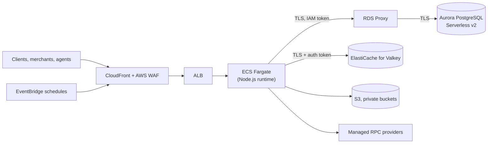

# AWS data plane: implementation status (25 October 2026)

> **Nothing described here is deployed.** furlpay.com runs on Vercel, Supabase and Upstash. This page records what has been **implemented and tested in the application repository** for the AWS move decided on 22 October 2026, what has **not been verified on AWS**, and what is **blocked**. It supersedes the "in progress" status in the [PostgreSQL migration plan](AWS-POSTGRESQL-MIGRATION.md). Status labels follow the [enterprise architecture](../docs/ENTERPRISE-ARCHITECTURE-2026-2027.md).

## Target, per environment

Region eu-west-1. No self-operated blockchain nodes, no Lightning infrastructure, no Nitro Enclave signing: none of these is part of this migration.

## Status

| Component | Status | Evidence |
|---|---|---|
| PostgreSQL data layer (native `pg` driver) replacing PostgREST | **Implemented, tested locally** | Unit tests; integration tests on a real PostgreSQL server |
| Least-privilege database roles: the application owns nothing, has no exemption from row-level security, and cannot create objects | **Implemented, tested locally** | The full migration chain applied under the AWS role model; the application role is refused CREATE, DROP, TRUNCATE, disabling RLS and adding policies |
| Payments and ledger guarantees under that role model | **Implemented, tested locally** | One payment per (user, idempotency key) enforced by the database; unbalanced and single-legged ledger transactions rejected; a retry cannot double-post; **exactly-once settlement under 10 concurrent attempts** |
| Verified TLS to the database; IAM authentication to RDS Proxy (no database password in the application) | **Implemented, tested locally; not verified on AWS** | Token signing matches the AWS SDK's reference implementation; a connection-string setting that would have dropped certificate verification is now refused |
| Split-brain guard: each database records which platform may use it; a deployment refuses any other | **Implemented, tested locally** | Cutover additionally fences the old database at the database level (see below) |
| ElastiCache for Valkey as the key-value store (TCP + TLS, certificate verification on) | **Implemented; adapter tested; live atomicity not yet tested** | Integration suite against a real Valkey server written, **not yet run** |
| Exactly one key-value store per environment | **Implemented, tested locally** | Configuring both is refused |
| Middleware on the Node.js runtime | **Verified in the production build** | — |
| No server-only module in browser bundles | **Verified** | Build output scan plus a test over every client component's imports |
| Private S3 buckets for onboarding documents and research PDFs | **Implemented, not verified on AWS** | Block Public Access, ACLs disabled, SSE-KMS, TLS-only |
| Scheduled jobs: every current Vercel job has an EventBridge equivalent | **Implemented, not verified on AWS; disabled by default** | Enabled per environment only when Vercel no longer runs the same jobs against that database |
| Hedged read-only RPC requests across managed providers | **Implemented, tested; off by default** | Broadcasts are never hedged |
| Latency metrics (database, key-value, RPC, event loop) and alarms | **Implemented, tested locally** | — |
| Infrastructure as code | **Validated, not applied** | `terraform validate` for every environment; plan-level tests with mocked providers. No plan against real AWS state yet |
| Production | **Not started** | Production keeps the AWS data plane off until its cutover is approved |

## Cutover, in outline

1. Bootstrap the new database and apply every migration under the least-privilege role model.
2. **Fence the source database at the database level**: mark it retired, revoke the application's login and end its sessions. The application's own 30-second re-check is not, by itself, a barrier; the revoke is.
3. Copy the data, reconcile (ledger balance, payment counts and states) before anything writes to the target.
4. Declare the target for AWS, switch traffic, and move scheduled jobs in the same change.
5. Rollback before step 4: re-enable the source. After it: the same procedure in reverse. There is no dual-write and no automatic fallback between databases.

## Measured so far

Only a **local** benchmark (one developer machine, embedded PostgreSQL, no network, no TLS, no RDS Proxy): balanced ledger postings at 100 concurrent requests completed with zero errors and books balanced afterwards. These numbers describe the code path, not AWS; **no staging or production latency has been measured**, and published latency figures elsewhere are targets.

## Blocked / next

- A real Valkey server for the key-value integration suite.
- AWS credentials for a staging `terraform plan`, then an approved staging apply.
- A cutover rehearsal on staging before any production plan.
