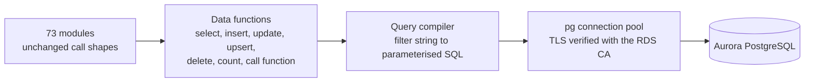
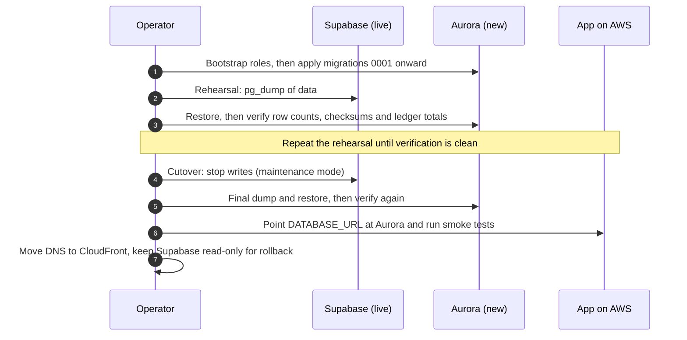

# AWS PostgreSQL Migration — Supabase to Aurora/RDS

> **Status, 22 October 2026.** **Decided:** FurlPay will run on Amazon Aurora PostgreSQL, reached with the native Node.js `pg` driver, with Amazon S3 in place of Supabase Storage. **In progress:** the data layer is being rewritten in the application repository; it is not merged. **Not started:** no AWS database exists; production still runs on Supabase. Status labels are defined in the [enterprise architecture](../docs/ENTERPRISE-ARCHITECTURE-2026-2027.md).

---

## 1. What the application depends on today

Counted in the application source at commit **`7a392b87`** (`release/2026-10-21`, the build serving furlpay.com as deployment `dpl_Bsz8p…`), by code search on 22 October 2026. Method: occurrences of each data function followed by `(` or a type argument `<`, excluding tests and the data module itself; SQL functions are the distinct string literals passed to the RPC call. Recounted for this revision: **unchanged**.

| Dependency | Count |
| :--- | :--- |
| PostgREST calls through the shared data module (`lib/supabase.ts`) | **396** call sites in **73** modules |
| — select / update / call SQL function / insert / upsert / insert-ignoring-duplicates / delete / count | 194 / 42 / 90 / 21 / 18 / 13 / 9 / 9 |
| Distinct SQL functions called over RPC | **68** |
| Modules calling Supabase directly, outside the shared module | **3**: notifications (count query), research PDFs (Storage signed URLs), onboarding documents (Storage upload, read, delete) |
| SQL migrations | **58** files |
| Supabase-specific objects in migrations | Grants to the `anon`, `authenticated` and `service_role` roles; one insert into `storage.buckets` (migration 0038); row-level security enabled on 116 tables, with **no policies** |
| Supabase Auth (`auth.uid()`, `auth.users`) | **Not used.** FurlPay authenticates users itself (passkeys, OTP, OAuth). Two migrations mention `auth.` only in comments. |
| Extensions | `citext`, `pg_trgm`, `postgis`: all available on Aurora PostgreSQL |

**Open branches change the totals slightly.** The infrastructure branch (`feat/resilience-hardening`) is identical. The community branch (PR #172, not merged) adds 7 call sites in 1 module, 2 SQL functions and migration 0068, which would make 403 call sites, 74 modules, 70 functions and 59 migrations if merged first.

The PostgREST syntax actually used is a small, regular subset: equality and comparison filters, `in`, `is`, `like`/`ilike`, array containment, `not.`, `or=(…)`, JSON paths (`->`, `->>`), aliases and casts in `select`, one level of embedded related rows, and `order`/`limit`/`offset`.

---

## 2. Options compared

| | Stay on Supabase | Amazon RDS for PostgreSQL | **Amazon Aurora PostgreSQL (chosen)** |
| :--- | :--- | :--- | :--- |
| Network path | Public internet, PostgREST over HTTPS | Private VPC, PostgreSQL protocol | Private VPC, PostgreSQL protocol |
| Multi-statement transactions from the app | Only inside SQL functions (each PostgREST call is its own transaction) | Yes | Yes |
| High availability | Provider-managed | Multi-AZ standby; failover typically 60–120 s | Shared storage across three AZs; reader promoted on failure, typically faster than RDS Multi-AZ |
| Scaling | Plan tiers | Instance resize (downtime or failover) | Serverless v2 scales in 0.5 ACU steps within a configured range |
| Backups | Provider plan | Automated backups, point-in-time recovery | Continuous backup to S3, point-in-time recovery |
| Operational responsibility | Lowest | Parameter groups, upgrades, sizing | Same as RDS, minus storage sizing |
| Fit with the rest of the platform | Separate vendor, separate network, separate IAM | Same VPC, IAM, KMS and CloudWatch as the app | Same, and already the choice in FurlPay's Terraform |
| Migration effort | None | Data layer rewrite; dump and restore | Same as RDS |

**Why Aurora over RDS:** the Terraform in the application repository already defines Aurora PostgreSQL 16 with Serverless v2 instances (0.5–2 ACU), and FurlPay's load is spiky and small, which suits Serverless v2. RDS for PostgreSQL remains a valid fallback if Aurora's minimum capacity cost outweighs failover speed. The data layer is the same for both.

**Why not stay:** the database is reachable only through an HTTP API on the public internet, so multi-step money operations cannot share a transaction unless they are written as SQL functions. It also sits outside the network, identity and audit boundary the rest of the platform is moving into. Staying would leave the web tier on AWS calling a database over the public internet.

---

## 3. Preserving the adapter interface

The safest migration changes the transport, not 73 modules' logic.

How the new layer works (**IMPLEMENTED, TESTED on a feature branch; not merged**):

- **Parameterised SQL only.** Identifiers must match `^[a-z_][a-z0-9_]*$` and are quoted; every value is a bind parameter. An operator or construct the compiler does not understand is an error, never "no filter". A dropped filter would return more rows, which is the dangerous direction.
- **PostgreSQL serialises the results** (`json_agg`, `to_json`), exactly as PostgREST did. Timestamps, `numeric`, `bigint` and `bytea` reach callers in the representation they already parse. Sessions are pinned to UTC so timestamps keep their `+00:00` form.
- **SQL functions are called with named arguments** converted from one JSON document to each parameter's declared type (`json_to_record`), as PostgREST did. Return shapes match: scalar, single row, set of rows, or void. A missing function raises a typed error that callers already handle.
- **Upserts update only the columns supplied,** and conflict on the widest unique key the row covers. Re-attesting a record can therefore never clear a column such as a revocation timestamp.
- **Writes with mixed column sets** are grouped and run in one transaction, so a missing key means "use the column default", never "write NULL".
- **Errors keep PostgreSQL's SQLSTATE and message** (e.g. `23505` for a duplicate key becomes HTTP 409; a raised exception keeps its text), because callers branch on them.

Validation so far: 18 tests of the compiler and data layer against a real PostgreSQL engine; the control-plane and API integration suites (203 tests, including cross-tenant isolation) pass through the new layer unchanged. Storage request signing reproduces AWS's published SigV4 test vectors exactly.

---

## 4. Transactions, money and idempotency

| Requirement | How |
| :--- | :--- |
| Atomic multi-row money operations | Stay inside SQL functions (`settle_payment_atomic`, `ledger_post`, `merchant_payment_receive` and others), which run in one transaction with row locks. The `pg` driver additionally allows application-side `BEGIN … COMMIT`. The first users are the two places that today write a payment and its audit event as separate statements (see the [ledger document](../docs/LEDGER-SETTLEMENT-RECONCILIATION.md)). |
| Exact monetary values | Ledger postings are `bigint` minor units. `numeric` columns are returned as JSON numbers by default; where a value can exceed 2^53, callers select it with a `::text` cast and parse it into `BigInt`. This is already the pattern for on-chain supply figures. |
| Idempotency | Database-enforced: unique keys on idempotency keys and on `(chain, tx_hash, log_index)` receipts; "insert, ignoring duplicates" for event logs. |
| No silent fallback | An unreachable database is an error (HTTP 503), never an in-memory substitute. On the feature branch, a production process also refuses to start without `DATABASE_URL` and `DATABASE_CA_CERT`. |

---

## 5. Tenant isolation, roles and RLS

**Tenant isolation is not relaxed by this migration.**

Today every table has row-level security enabled with no policies, and the server connects with Supabase's `service_role`, which bypasses RLS. In effect the database denies every other role, and tenant scoping is enforced in the application: every query filters on the caller's organization or user. The control-plane tests prove this against a real PostgreSQL engine; a query that dropped its tenant filter would fail them.

Target roles on Aurora (**PLANNED**):

| Role | Can | Used by |
| :--- | :--- | :--- |
| `furlpay_owner` | Own the schema; run DDL | The migration job only, never the running app |
| `furlpay_app` | `SELECT/INSERT/UPDATE/DELETE` on application tables; `EXECUTE` on application functions; no DDL; `UPDATE`/`DELETE` on `ledger_postings` still refused by its trigger | The web and worker tasks |
| `anon`, `authenticated`, `service_role` | Nothing; created `NOLOGIN` only so the existing migrations' `GRANT`/`REVOKE` statements apply unchanged | — |

Because RLS is enabled with no policies, a non-owner role such as `furlpay_app` sees no rows until it is granted access. A new migration therefore adds, per table, a policy for `furlpay_app` that keeps today's application-enforced scoping. Database-enforced tenant policies, keyed on `SET LOCAL app.organization_id` inside each transaction, are a further layer (**RESEARCH**). They must be designed with connection pooling in mind: with RDS Proxy, session-level `SET` statements pin connections.

The feature-branch code currently connects as the schema owner. Switching it to `furlpay_app` is a tracked backlog item that must be done before cutover.

---

## 6. Identity, TLS and network

| Concern | Current Terraform | Required |
| :--- | :--- | :--- |
| Who the app connects as | The Aurora **master** user, named `furlpay_app`, with a Terraform-generated password (therefore in Terraform state) | RDS-managed master password in Secrets Manager (`manage_master_user_password`); separate `furlpay_owner` and `furlpay_app` roles (§5); `DATABASE_URL` built for the runtime role |
| Authentication | Password | Password from Secrets Manager first. **IAM database authentication** (short-lived tokens from the task role) is an option once the runtime role exists; it removes the stored password but adds a token-refresh path to the pool |
| TLS | `DATABASE_URL` ends `?sslmode=require`; no CA supplied | The RDS CA bundle supplied as `DATABASE_CA_CERT`, with certificate verification proven by a negative test (a wrong CA must fail) |
| Network | Database accepts 5432 only from the task security group; tasks reach 5432/6379 only inside the VPC | Unchanged. No public endpoint; operators connect through a bastion-less path (SSM Session Manager port forwarding), never a public listener |
| Provisioning | `enable_aws_data_plane = false` everywhere, so no cluster exists in any plan | Enable per environment after the data layer merges |

Full detail: [Terraform reconciliation](TERRAFORM-RECONCILIATION-2026-10.md), rows T1–T4.

## 7. Connections

- **ECS Fargate tasks are long-lived,** so each task keeps a small pool (default 10, set with `DATABASE_POOL_MAX`) and RDS Proxy is not required for the first release.
- **RDS Proxy becomes worthwhile** if short-lived workers (Lambda) are added, or if task counts make total connections approach the cluster's limit. Note its pinning rules for PostgreSQL: `SET` and `set_config` pin a session. `TimeZone` is accepted as a startup parameter, so UTC should be passed that way rather than through `options` or `SET` (backlog item).
- **TLS is verified.** Amazon RDS certificates chain to the RDS CA, which is not in Node's default trust store. The app requires the [RDS global bundle](https://truststore.pki.rds.amazonaws.com/global/global-bundle.pem) in `DATABASE_CA_CERT` and refuses a remote connection without it.
- **Statement timeout** defaults to 15 s per connection.

---

## 8. Storage: Supabase Storage → Amazon S3

| Bucket | Contents | Access |
| :--- | :--- | :--- |
| `KYB_DOCUMENTS_BUCKET` | Business onboarding documents | Server-only upload with `If-None-Match: *` (never overwrites); reads proxied through the app to an authorised reviewer |
| `RESEARCH_PDF_BUCKET` | Gated research PDFs | 60-second presigned URL after email verification |
| Evidence bucket | Payment evidence bundles | **PLANNED** with S3 Object Lock; see [AWS Data and Event Infrastructure](AWS-DATA-EVENT-INFRASTRUCTURE.md) |

All buckets are private (Block Public Access on), encrypted with SSE-KMS, and accessed with the ECS task role's credentials. Requests are signed with SigV4 without an SDK. **None of these buckets exists in Terraform yet** (reconciliation row T10).

**Moving existing objects.** Copy every object from the Supabase buckets to S3 with its key unchanged. Then verify, per object: byte size equal; SHA-256 of the source bytes equal to the SHA-256 stored with the S3 object (sent as `x-amz-checksum-sha256` on upload, so S3 itself rejects a corrupted transfer); and the onboarding record's stored size equal to the object size (the read path already refuses a mismatch). Report counts of copied, verified and failed objects; cut over only when failures are zero.

---

## 9. Migration and cutover

**Ordering.**
1. Bootstrap: create the `NOLOGIN` compatibility roles and a stub `storage.buckets` table, which migration 0038 inserts into and nothing reads.
2. Apply the 58 migrations in order.
3. Add the `furlpay_app` grants and policies migration.
4. Restore data.

The migration-hygiene rule still holds: applied migrations are never edited, and corrections are new migrations.

**Verification before switching traffic.**
- Row counts for every table.
- An order-independent checksum of each table's primary keys and `updated_at`.
- Ledger totals per account, which must equal the source.
- The `ledger_imbalance` view must report an imbalance of 0.
- The `payments_missing_ledger` view must be identical before and after.

**Alternative considered: continuous replication.** PostgreSQL logical replication (or AWS DMS) from Supabase into Aurora would shorten the write freeze to the final catch-up. It needs a replication-capable connection to the Supabase project, publications on every table, and care with sequences and functions, which logical replication does not carry. Given FurlPay's small data volume, a dump and restore inside a short maintenance window is simpler and easier to verify. Replication is the fallback if the rehearsal shows the window would be too long.

**Rollback.** Until the first write lands on Aurora, rollback is a configuration change back to Supabase. After that, writes made on Aurora must be replayed to Supabase or the rollback window closes. The cutover is therefore short, scheduled, and preceded by maintenance mode.

**Backups.** Aurora continuous backups with point-in-time recovery (35 days in production, per Terraform), plus a restore drill in staging before cutover. A cross-region snapshot copy is planned. No recovery time has been measured yet.

## 10. Failure behaviour after cutover

| Event | Behaviour |
| :--- | :--- |
| Writer fails over to the reader | In-flight statements fail and the pool reconnects. Money operations are safe to retry: settlement and receipt functions are idempotent by key, and a status change is conditional on the expected prior status |
| Database unreachable | Requests that need it return 503; nothing falls back to memory in production |
| A migration missing in production | Today some paths treat this as "not durable" (ledger gap G2); the requirement is a 503 and a boot-time schema check |
| Statement exceeds 15 s | Cancelled by `statement_timeout`; the caller sees an error, not a hang |

## 11. Risks

| Risk | Mitigation |
| :--- | :--- |
| A PostgREST behaviour the compiler does not reproduce | Unsupported constructs throw; integration suites run real call sites against real PostgreSQL |
| Precision loss on very large `numeric` values | `::text` selects for values that can exceed 2^53; ledger uses `bigint` |
| Runtime role too powerful | Separate owner and app roles before cutover |
| Connection exhaustion | Per-task pool cap; RDS Proxy if workers are added |
| Data drift during cutover | Maintenance mode; verified final restore |

## 12. Required application changes (not documentation)

Tracked in the [backlog](../docs/IMPLEMENTATION-BACKLOG-2026-10.md): the data layer and S3 storage (A1, A2), the runtime role (A3), the bootstrap script (A4), `TimeZone` as a startup parameter (A5), Terraform data-plane and secret changes (A6, T1–T4), and moving credentials out of Redis (D2). **None is merged.**

---
