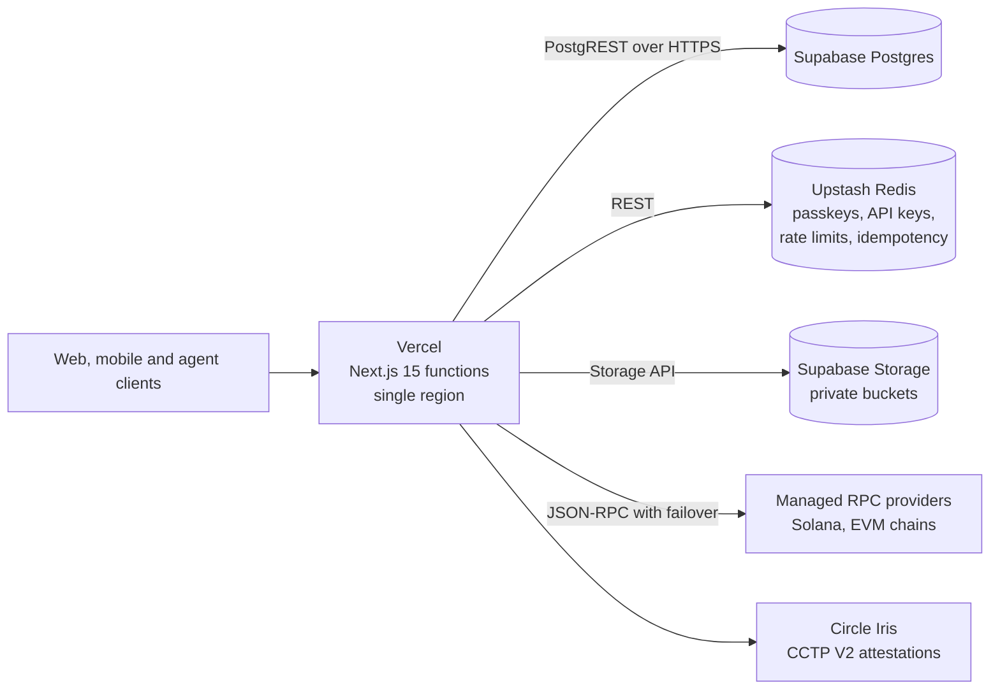
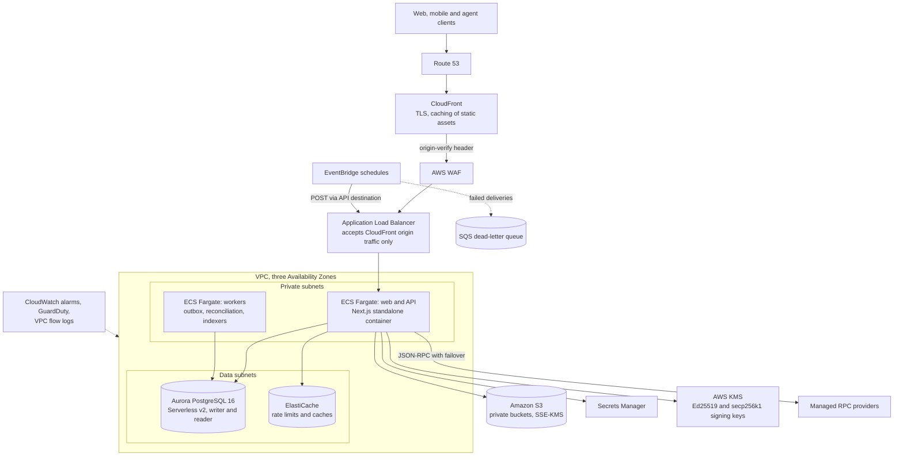
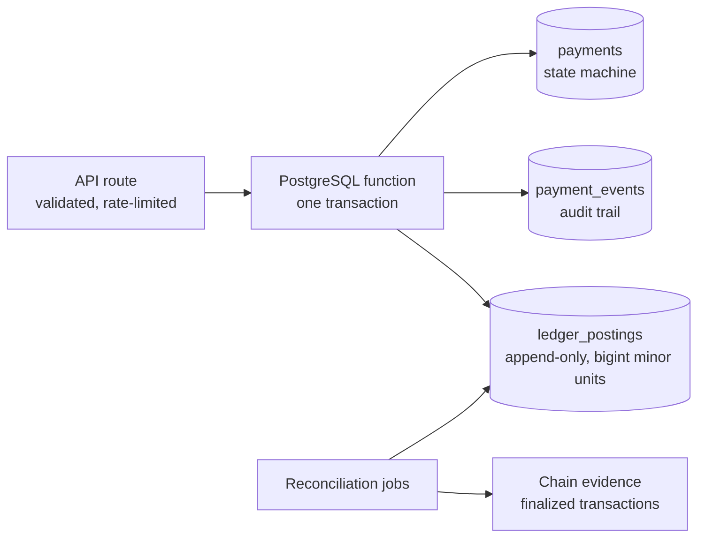
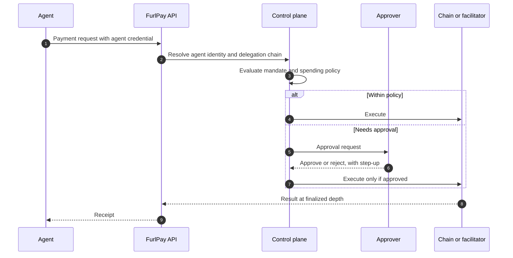
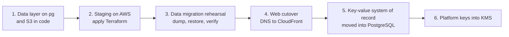

# FurlPay Enterprise Financial Infrastructure Architecture — AWS, Solana Alpenglow and Programmable Payments (2026–2027)

> **Status, 22 October 2026.** On 22 October 2026 FurlPay decided to move its production platform from Vercel and Supabase to Amazon Web Services. **The migration has started in code and has not been deployed.** furlpay.com still runs on Vercel, Supabase Postgres and Upstash Redis. Nothing in this document describes a running AWS workload unless it is labelled **LIVE**.

**Status labels used in this document**

| Label | Meaning |
| :--- | :--- |
| **LIVE** | Deployed to furlpay.com and verified there. |
| **IMPLEMENTED** | Exists in the application source; not confirmed as deployed. |
| **TESTED** | Covered by reproducible tests in the application repository. |
| **PLANNED** | Decided design, not deployed. |
| **RESEARCH** | Under evaluation; no decision. |
| **BLOCKED** | Waiting on an external dependency, licence, approval or remediation. |

These map onto the [README's status categories](../README.md#current-status-22-october-2026): LIVE is *Production*, IMPLEMENTED/TESTED is *Implemented, not deployed*, and PLANNED is *Planned*.

Companion documents:
- [Solana Alpenglow Integration and Finality Architecture](SOLANA-ALPENGLOW-FINALITY.md)
- [AWS PostgreSQL Migration — Supabase to Aurora/RDS](../aws/AWS-POSTGRESQL-MIGRATION.md)
- [Financial Ledger, Settlement and Reconciliation Architecture](LEDGER-SETTLEMENT-RECONCILIATION.md)
- [AWS Security, Cryptographic Signing and Enterprise Controls](../aws/AWS-SECURITY-SIGNING-CONTROLS.md)
- [AWS Data and Event Infrastructure](../aws/AWS-DATA-EVENT-INFRASTRUCTURE.md)
- [Payment Rails and Partner Status](PAYMENT-RAILS-STATUS.md)
- [Implementation backlog, October 2026](IMPLEMENTATION-BACKLOG-2026-10.md)
- [Review of the October 2026 enterprise master report](../reports/ENTERPRISE-MASTER-REPORT-REVIEW-2026-10.md)

---

## 1. Executive overview

FurlPay is a payment platform for stablecoins: merchant checkout, payouts and payroll, agent-initiated payments over HTTP 402, and an operator console. It is one Next.js 15 application (`apps/web`) that serves the website, the API used by the mobile apps, and scheduled jobs.

The architecture rests on three decisions:

1. **PostgreSQL is the system of record for money.** Ledger postings, payment state and settlement claims live in PostgreSQL, enforced by database constraints and functions, not by application memory. This holds on Supabase today and on Aurora after the migration.
2. **Finality is read from the chain, never assumed.** A payment is credited only at `finalized` commitment. Solana's Alpenglow upgrade (live since 21 October 2026) shortens how long that takes. It does not change the rule.
3. **Managed services before self-operated infrastructure.** FurlPay uses managed RPC providers with failover and AWS managed services. It does not run Solana validators or RPC nodes, and the target design does not require it to.

**Why AWS.** The platform's remaining risks are operational: a REST key-value store that reached its plan limit on 21 October, a database reached only through PostgREST, deployment on a single provider's serverless functions, and no infrastructure-as-code in production. AWS gives private networking, managed PostgreSQL with point-in-time recovery, KMS-held signing keys (including Ed25519 since November 2025), and infrastructure defined in Terraform that already exists in the application repository.

---

## 2. Current deployment topology (LIVE)

| Component | Status | Notes |
| :--- | :--- | :--- |
| Web app and API on Vercel | **LIVE** | furlpay.com. |
| Supabase Postgres | **LIVE** | 58 SQL migrations in the repository. The app reaches the database only through PostgREST. |
| Upstash Redis | **LIVE, degraded** | At its plan capacity on 21 October 2026; dependent endpoints fail closed. |
| Merchant stablecoin acceptance | **IMPLEMENTED, switched off** | No settlement assets enabled in production. |
| AWS | **PLANNED** | Account exists; Terraform exists and has not been applied. |

---

## 3. Target AWS infrastructure (PLANNED)

The target is defined in Terraform in the application repository (`infra/aws`). None of it has been applied.

| Layer | Choice | Why |
| :--- | :--- | :--- |
| Compute | ECS Fargate, multi-AZ | Container parity with local builds; no cold starts on authorization paths; App Runner stopped accepting new customers on 30 April 2026. Full reasoning: [Web — Vercel → AWS](../deploy/WEB-AWS.md). |
| Edge | CloudFront → WAF → ALB | ALB accepts only CloudFront's managed prefix list plus a secret origin-verify header. |
| Database | Aurora PostgreSQL 16, Serverless v2 | Already chosen in Terraform. Two instances across Availability Zones for failover; point-in-time recovery. See [§9](#9-database-architecture-and-data-migration). |
| Object storage | S3, private, SSE-KMS, Block Public Access | Replaces Supabase Storage for onboarding documents and gated research PDFs. |
| Schedules | EventBridge → API destination (POST) | Replaces Vercel cron; failed deliveries land in an SQS dead-letter queue. |
| Secrets and keys | Secrets Manager; KMS | No secrets in images or task definitions. |
| Solana and EVM access | Managed RPC providers with failover | No self-operated nodes. See [§5](#5-solana-transaction-lifecycle-and-finality-verification). |

**Deliberately not in the first AWS release:** dedicated Solana RPC nodes, Kinesis, MSK, DynamoDB, Global Accelerator, multi-region active-active. [AWS Data and Event Infrastructure](../aws/AWS-DATA-EVENT-INFRASTRUCTURE.md) explains each.

---

## 4. Financial system of record

What the schema already enforces (**IMPLEMENTED, TESTED**):
- `ledger_post` refuses a transaction with fewer than two postings, and refuses one whose debits and credits differ.
- `ledger_postings` is append-only: a trigger rejects every `UPDATE` and `DELETE`.
- Posting amounts are `bigint` minor units, never floating point.
- `settle_payment_atomic` locks the payment row (`SELECT … FOR UPDATE`), marks it settled and posts its ledger entry in **one** transaction. A concurrent second settlement sees the first and reports a replay instead of posting twice.

What is not yet enforced, and is required before live settlement, is listed in [Financial Ledger, Settlement and Reconciliation](LEDGER-SETTLEMENT-RECONCILIATION.md).

---

## 5. Solana transaction lifecycle and finality verification

Solana's Alpenglow consensus has been live on mainnet since 21 October 2026 (epoch 1064). It targets roughly 150 ms finality, against about 12.8 s under TowerBFT, and `confirmed` and `finalized` now describe the same state.

FurlPay's rules do not change:
- **Credit at `finalized`.** Merchant Solana payments are read with `commitment: "finalized"` (IMPLEMENTED). Under Alpenglow, that is the confirmation that used to be optimistic, and it is also final.
- **Measure, don't assume.** 150 ms is consensus finality. A customer's wait also includes signing, policy checks, RPC submission, our polling cadence and the database write.
- **Read the consensus from the chain.** A branch of the application reads the Alpenglow feature account and the genesis certificate from mainnet before applying Alpenglow timing, and falls back to TowerBFT timing if it cannot (**IMPLEMENTED, TESTED; not merged or deployed**).

Full detail, including `bank_id`, cross-provider reconciliation and failure handling: [Solana Alpenglow Integration and Finality Architecture](SOLANA-ALPENGLOW-FINALITY.md).

---

## 6. Stablecoin settlement architecture

| Flow | Path | Status |
| :--- | :--- | :--- |
| Merchant checkout (USDC on Solana, Base, Arbitrum, Arc, Polygon, Ethereum, Sui) | Single-use destination per payment → chain scan at finalized depth → `merchant_payment_receive` → ledger | **IMPLEMENTED, switched off in production** |
| Agent payments over HTTP 402 (x402) | Facilitator verifies an EIP-3009 authorization, settles, records it single-use | **IMPLEMENTED** |
| Cross-chain USDC (Circle CCTP V2) | Burn → Iris attestation → mint on destination | **IMPLEMENTED** (attestation-driven; completion depends on the destination mint, not on source-chain finality alone) |
| Card spend | Partner issuer authorizes against the user's balance | **BLOCKED**: no card issuer contracted; feature flag off |
| Fiat on-ramp and off-ramp | Licensed provider | **BLOCKED**: no provider contracted |

Rails and partner status in full: [Payment Rails and Partner Status](PAYMENT-RAILS-STATUS.md).

---

## 7. Wallet and custody infrastructure

| Key | Where it lives | Status |
| :--- | :--- | :--- |
| End-user wallet keys | On the user's device: Android Keystore, Apple Secure Enclave; SLIP-0010 Ed25519 and BIP-44 secp256k1 derivation | **IMPLEMENTED** in the mobile apps |
| Server-side MPC signing | A signing route integrates an MPC wallet provider | **IMPLEMENTED**; production use not verified |
| Platform keys (fee payer, x402 facilitator) | Today: environment secrets. Target: AWS KMS asymmetric keys (Ed25519 for Solana, secp256k1 for EVM), so private keys never leave KMS | **PLANNED** |
| Nitro Enclaves for policy-bound signing | Isolated signing with attestation | **RESEARCH** |
| Smart-contract accounts (e.g. Safe) | Not integrated | **RESEARCH** |

Custody positions per balance: [Balance Custody Map](BALANCE-CUSTODY-MAP.md) and [Custody Disclosure](CUSTODY-DISCLOSURE.md).

---

## 8. Agentic payment authorization

The control plane (agent identity, delegation chain, mandates, recipient attestation, approvals) is **IMPLEMENTED, TESTED**: its tenant-isolation tests run against a real PostgreSQL engine. HTTP 402 payments are covered in [x402 Attack Vectors](security/x402-attacks.md).

---

## 9. Database architecture and data migration

**Decision (22 October 2026):** Aurora PostgreSQL, reached from the application with the native `pg` driver; Amazon S3 replaces Supabase Storage. **Status: in progress in code, not deployed.**

- The application keeps its existing data-access functions (select, insert, update, upsert, delete, count, call a SQL function). A new layer compiles the same filter strings into parameterised SQL and lets PostgreSQL serialise the JSON results, so the 73 calling modules do not change behaviour.
- Row-level security stays enabled. Tenant isolation remains enforced in the application, as it is today, and the migration adds a least-privilege runtime role. Nothing is relaxed.
- The 58 existing migrations remain the schema; a bootstrap script provides the roles they reference.

Comparison of Aurora, RDS and staying on Supabase, the cutover plan and the rollback plan: [AWS PostgreSQL Migration](../aws/AWS-POSTGRESQL-MIGRATION.md).

---

## 10. Monitoring and observability

| Signal | Mechanism | Status |
| :--- | :--- | :--- |
| Chain head freshness per collectable chain, with RPC failover state | Operations console and alerts | **IMPLEMENTED** for EVM chains; Solana added on a branch (not merged) |
| Solana consensus mode (Alpenglow or TowerBFT) read from mainnet | Operations console | **IMPLEMENTED, TESTED** on a branch (not merged) |
| Credit latency p50/p95/p99 per chain, from stored receipts | Operations console | **IMPLEMENTED, TESTED** on a branch (not merged) |
| Ledger imbalance and payments without ledger entries | Reconciliation queries | **IMPLEMENTED** |
| Infrastructure alarms, GuardDuty, VPC flow logs, WAF metrics | CloudWatch, SNS | **PLANNED** (in Terraform) |

Credit latency is measured from block time to the moment the receipt is recorded, with one-second resolution. It includes finality, polling and RPC time, and is **not** presented as consensus finality.

---

## 11. Security and compliance controls

Summary; the full treatment is in [AWS Security, Cryptographic Signing and Enterprise Controls](../aws/AWS-SECURITY-SIGNING-CONTROLS.md) and the [AWS Security Baseline](../deploy/AWS-SECURITY-BASELINE.md).

- Every mutating API route validates its body with a schema and has a size cap; public routes are rate-limited; webhooks verify HMAC signatures over the raw body with timestamp checks (**IMPLEMENTED**).
- Money routes screen wallet addresses against the OFAC SDN list locally, add Circle's Compliance Engine where configured and Arc's USDC blocklist on Arc, and fail closed (**IMPLEMENTED**). An older wallet-risk service still returns demonstration scores and is scheduled for replacement ([backlog](IMPLEMENTATION-BACKLOG-2026-10.md)).
- **FurlPay holds no PCI DSS or SOC 2 certification and has had no third-party security audit.** Both certifications are goals, and the controls are mapped toward them.

---

## 12. Disaster recovery and business continuity

| Concern | Target design | Status |
| :--- | :--- | :--- |
| Database failure | Aurora writer and reader in different Availability Zones; automatic failover | **PLANNED**. Terraform's `multi_az` and `deletion_protection` default to off and must be set for production. |
| Data loss | Aurora continuous backups with point-in-time recovery; cross-region snapshot copy | PITR **PLANNED**; cross-region copy **PLANNED** (not yet in Terraform) |
| Zone failure (compute) | ECS tasks spread across three Availability Zones behind the ALB | **PLANNED** |
| Region failure | Restore into a second region from snapshots | **PLANNED**; no recovery time has been measured |
| Provider outage (RPC) | Ordered endpoint failover with per-endpoint chain-identity proof | **IMPLEMENTED** |

No recovery time or recovery point objective has been tested. Targets will be published here when a restore drill has measured them. See also [Resilience: Principles & Status](../deploy/RESILIENCE.md).

---

## 13. Infrastructure cost assumptions

FurlPay has not incurred AWS spend for this architecture. Cost depends on Aurora capacity units consumed (Terraform sets 0.5–2 ACU), Fargate task size and count, NAT gateway hours and data transfer, and CloudFront traffic. These will be measured in staging before a figure is published. The earlier [AWS Cost Model](../aws/FURLPAY_AWS_COST_OPTIMIZATION_REPORT.md) assumed self-operated Solana nodes, which this architecture does not include, so its totals do not apply.

---

## 14. Dependencies and roadmap

| Step | Depends on | Status |
| :--- | :--- | :--- |
| 1. PostgreSQL data layer and S3 storage in the application | — | **In progress** (code, not merged) |
| 2. Staging environment on AWS | Step 1; AWS account access; region decision | **PLANNED** |
| 3. Data migration rehearsal with row-count and checksum verification | Step 2 | **PLANNED** |
| 4. Production cutover, with Vercel kept warm for rollback | Steps 1–3; passkey verification on the new origin | **PLANNED** |
| 5. Move passkeys, API keys, OAuth clients and x402 settlement records from Redis into PostgreSQL | Step 4 | **PLANNED** |
| 6. Platform signing keys into KMS | Step 4 | **PLANNED** |

The working list with owners and acceptance criteria: [Implementation backlog, October 2026](IMPLEMENTATION-BACKLOG-2026-10.md).

---

### Sources

- Solana: [Alpenglow upgrade page](https://solana.com/upgrades/alpenglow); [Anza Alpenglow documentation](https://docs.anza.xyz/consensus/alpenglow).
- Triton One: [Alpenglow and your Triton stack](https://blog.triton.one/alpenglow-and-your-triton-stack-what-to-update-before-mainnet/).
- AWS: [KMS EdDSA support (7 November 2025)](https://aws.amazon.com/about-aws/whats-new/2025/11/aws-kms-edwards-curve-digital-signature-algorithm/); [S3 conditional writes (20 August 2024)](https://aws.amazon.com/about-aws/whats-new/2024/08/amazon-s3-conditional-writes); [RDS Proxy pinning](https://docs.aws.amazon.com/AmazonRDS/latest/AuroraUserGuide/rds-proxy-pinning.html).
- Mainnet values (feature activation slot, genesis certificate slot, client version) were read from Solana mainnet JSON-RPC on 22 October 2026.
