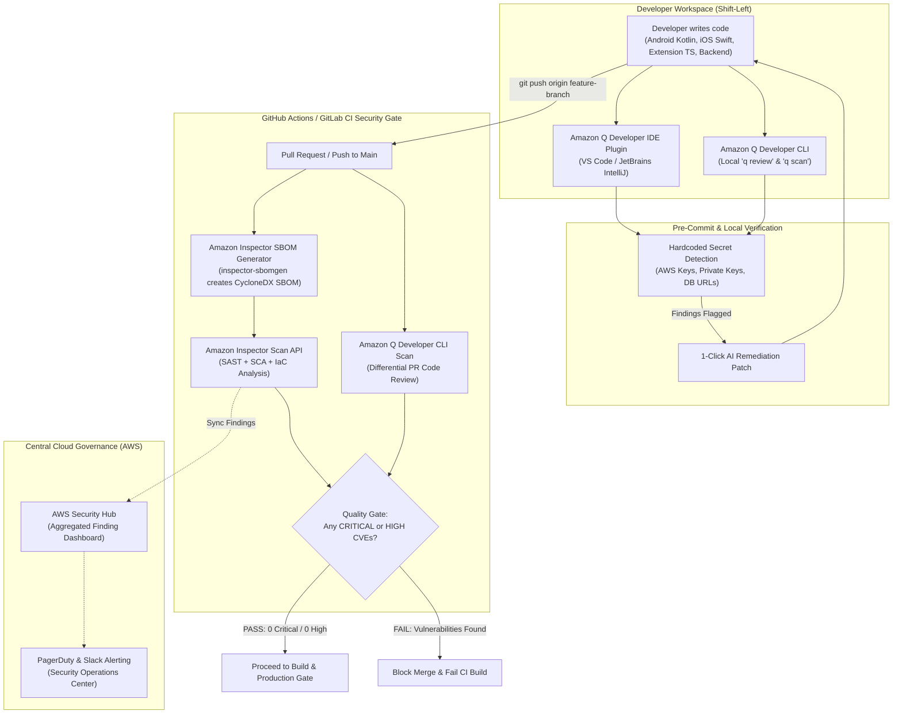

# FurlPay DevSecOps: Amazon Inspector Code Security, Software Supply Chain Governance, and Amazon Q Developer (2026 Edition)

**Author:** FurlPay DevSecOps & Security Engineering Group  
**Document Classification:** Production Reference Specification & Pipeline Guide  
**Target Systems:** Amazon Inspector Code Security, Amazon Q Developer, GitHub Actions, GitLab CI, `inspector-sbomgen`, AWS Security Hub  
**Document Version:** 2026.5.0  
**Effective Date:** November 2026  

---

## 1. Executive Summary & DevSecOps Strategy

FurlPay operates mission-critical digital-dollar rails processing real financial value across multiple blockchains and banking networks. Maintaining software security requires shifting security controls directly into the developer workflow and CI/CD automation pipelines.

The FurlPay DevSecOps architecture combines two foundational AWS security solutions:
1. **Amazon Inspector Code Security:** Continuous, automated Static Application Security Testing (SAST), Software Composition Analysis (SCA), and Infrastructure-as-Code (IaC) template analysis across GitHub/GitLab repositories and CI/CD pipelines, integrated with `inspector-sbomgen` for CycloneDX/SPDX Software Bill of Materials generation.
2. **Amazon Q Developer:** An intelligent, context-aware AI developer assistant providing inline IDE vulnerability scanning, secret detection, and one-click code remediations in Visual Studio Code, JetBrains IDEs, and the terminal CLI (`q review`, `q chat`).



---

## 2. Amazon Inspector Code Security Architecture

Amazon Inspector extends vulnerability management from cloud workloads (EC2, ECR, Lambda) directly to application source code, third-party libraries, and cloud infrastructure templates.

### 2.1 Core Inspection Engines

| Inspection Engine | Target Artifacts | Detection Capabilities | Supported Language Ecosystems |
| :--- | :--- | :--- | :--- |
| **Static Application Security Testing (SAST)** | Source code files, PR diffs | Remote Code Execution (RCE), SQL Injection, Cross-Site Scripting (XSS), Insecure Deserialization, Path Traversal | Kotlin, Swift, TypeScript/JavaScript, Python, Go, Java |
| **Software Composition Analysis (SCA)** | Dependency lockfiles (`package-lock.json`, `build.gradle.kts`, `Package.resolved`, `Cargo.lock`, `poetry.lock`) | Known Common Vulnerabilities and Exposures (CVEs) in open-source packages | npm, Gradle, Swift Package Manager, Cargo, pip/poetry |
| **Infrastructure as Code (IaC) Security** | Terraform (`.tf`), CloudFormation (`.yaml`/`.json`), AWS CDK | S3 bucket unencrypted, open security groups (`0.0.0.0/0`), missing IAM least-privilege policies, unrotated KMS keys | Terraform (HCL), CloudFormation, CDK |
| **Software Bill of Materials (SBOM)** | Complete codebase dependency trees | Generates machine-readable inventory of direct and transitive dependencies | CycloneDX v1.5, SPDX 2.3 |

---

## 3. Inspector SBOM Generator (`inspector-sbomgen`) Automation

The standalone CLI binary `inspector-sbomgen` extracts dependencies across FurlPay's polyglot repositories without uploading proprietary source code. The generated SBOM is then analyzed via the Amazon Inspector Scan API.

### 3.1 Installation & Generation Script (`scripts/generate_inspector_sbom.sh`)

```bash
#!/usr/bin/env bash
set -euo pipefail

# ==============================================================================
# FurlPay DevSecOps: Generate CycloneDX SBOM via inspector-sbomgen
# ==============================================================================

echo "=== Installing Amazon Inspector SBOM Generator ==="
SBOMGEN_VERSION="latest"
OS_TYPE="linux"
ARCH="amd64"

if ! command -v inspector-sbomgen &> /dev/null; then
    curl -sS -o /tmp/inspector-sbomgen "https://amazon-inspector-sbomgen.s3.amazonaws.com/${SBOMGEN_VERSION}/${OS_TYPE}/${ARCH}/inspector-sbomgen"
    chmod +x /tmp/inspector-sbomgen
    sudo mv /tmp/inspector-sbomgen /usr/local/bin/inspector-sbomgen
fi

inspector-sbomgen version

echo "=== Generating CycloneDX 1.5 JSON SBOM across Repository ==="
inspector-sbomgen directory \
    --path . \
    --output-path sbom-cyclonedx.json \
    --format cyclonedx-json \
    --disable-file-hashing=false

echo "SBOM generated successfully: sbom-cyclonedx.json"
ls -lh sbom-cyclonedx.json
```

---

## 4. Amazon Q Developer: AI-Assisted Security & Remediation

Amazon Q Developer integrates into local developer environments and CI/CD pipelines to detect security vulnerabilities and provide context-aware drop-in remediation patches.

### 4.1 CLI Commands & Automated Workflows

| Command | Operational Purpose | Example Usage in FurlPay Workflow |
| :--- | :--- | :--- |
| `q review` | Differential security code review across git branches | `q review --diff origin/main...HEAD --severity HIGH` |
| `q scan` | Comprehensive local workspace vulnerability scan | `q scan --target-dir apps/web/src` |
| `q chat` | Conversational terminal queries on AWS security best practices | `q chat "How do I enforce KMS envelope encryption on Bedrock?"` |

### 4.2 Automated Remediation Example: Hardcoded Private Key Elimination

When Amazon Q Developer identifies a hardcoded cryptographic secret or insecure storage pattern, it provides an automated one-click fix:

#### Vulnerable Code Detected (Kotlin Android)
```kotlin
// INSECURE: Hardcoded test key in source code
class PaymentAuthorizer {
    private val rawMasterKey = "0x4f3edf983ac636a65a842ce7c78d9aa706d3b113bce9c46f30d7d21715b23b1d"
    
    fun getAuthSignature(): String {
        return signWithKey(rawMasterKey)
    }
}
```

#### Amazon Q Developer AI Remediation Diff
```diff
--- a/apps/android/app/src/main/kotlin/PaymentAuthorizer.kt
+++ b/apps/android/app/src/main/kotlin/PaymentAuthorizer.kt
@@ -1,7 +1,11 @@
+import com.furlpay.mobile.security.AndroidKeyStoreManager
+
 class PaymentAuthorizer {
-    private val rawMasterKey = "0x4f3edf983ac636a65a842ce7c78d9aa706d3b113bce9c46f30d7d21715b23b1d"
+    private val keyStoreManager = AndroidKeyStoreManager()
     
-    fun getAuthSignature(): String {
-        return signWithKey(rawMasterKey)
+    fun getAuthSignature(payload: ByteArray): ByteArray {
+        // Secure: Key generated and signed entirely inside StrongBox hardware
+        return keyStoreManager.signPayload(payload)
     }
 }
```

---

## 5. Production CI/CD Pipeline Implementation

### 5.1 GitHub Actions Workflow (`.github/workflows/inspector-q-security.yml`)

The following production GitHub Actions workflow runs on every push and pull request to `main`. It assumes an AWS IAM role via OIDC, executes `inspector-sbomgen`, calls the Amazon Inspector Scan API, and runs the Amazon Q Developer CLI review.

```yaml
name: "FurlPay DevSecOps: Amazon Inspector & Amazon Q Security Gate"

on:
  push:
    branches: [ "main" ]
  pull_request:
    branches: [ "main" ]

permissions:
  id-token: write
  contents: read
  security-events: write

jobs:
  security-scan:
    name: "Amazon Inspector SAST/SCA & Amazon Q CLI Security Audit"
    runs-on: ubuntu-latest

    steps:
      - name: "Checkout Repository"
        uses: actions/checkout@v4
        with:
          fetch-depth: 0

      - name: "Set up Python Environment"
        uses: actions/setup-python@v5
        with:
          python-version: "3.11"

      - name: "Configure AWS Credentials via OIDC"
        uses: aws-actions/configure-aws-credentials@v4
        with:
          role-to-assume: ${{ secrets.AWS_INSPECTOR_CI_ROLE_ARN }}
          aws-region: "us-east-1"
          audience: "sts.amazonaws.com"

      - name: "Install Amazon Inspector SBOM Generator"
        run: |
          curl -sS -o /usr/local/bin/inspector-sbomgen "https://amazon-inspector-sbomgen.s3.amazonaws.com/latest/linux/amd64/inspector-sbomgen"
          chmod +x /usr/local/bin/inspector-sbomgen
          inspector-sbomgen version

      - name: "Generate CycloneDX SBOM"
        run: |
          inspector-sbomgen directory --path . --output-path sbom.json --format cyclonedx-json

      - name: "Execute Amazon Inspector Scan API & Enforce Security Gate"
        run: |
          python3 -c '
          import boto3, json, sys

          client = boto3.client("inspector-scan", region_name="us-east-1")
          with open("sbom.json", "rb") as f:
              sbom_bytes = f.read()

          response = client.scan_sbom(
              sbom=sbom_bytes,
              outputFormat="CYCLONEDX_1_5"
          )

          vulnerabilities = response.get("sbom", {}).get("vulnerabilities", [])
          critical_findings = [v for v in vulnerabilities if v.get("ratings", [{}])[0].get("severity") == "critical"]
          high_findings = [v for v in vulnerabilities if v.get("ratings", [{}])[0].get("severity") == "high"]

          print("=" * 60)
          print(f"AMAZON INSPECTOR SCAN RESULTS")
          print(f"Total Detected Vulnerabilities: {len(vulnerabilities)}")
          print(f"CRITICAL Severity: {len(critical_findings)}")
          print(f"HIGH Severity: {len(high_findings)}")
          print("=" * 60)

          for v in critical_findings:
              print(f"[CRITICAL] {v.get('id')}: {v.get('description', '')[:120]}...")
          for v in high_findings:
              print(f"[HIGH] {v.get('id')}: {v.get('description', '')[:120]}...")

          if len(critical_findings) > 0 or len(high_findings) > 0:
              print("\nSECURITY GATE FAILED: High/Critical vulnerabilities detected. PR blocked.")
              sys.exit(1)
          else:
              print("\nSECURITY GATE PASSED: Zero Critical or High vulnerabilities found.")
          '

      - name: "Run Amazon Q Developer CLI Differential Code Review"
        run: |
          npm install -g @aws/amazon-q-developer-cli
          echo "Running Amazon Q Developer differential code review..."
          q review --diff origin/main...HEAD --severity HIGH || true
```

### 5.2 GitLab CI Pipeline Configuration (`.gitlab-ci.yml`)

```yaml
stages:
  - security-audit
  - build

variables:
  AWS_DEFAULT_REGION: "us-east-1"

inspector_code_security:
  stage: security-audit
  image: amazon/aws-cli:latest
  script:
    - echo "=== Running Amazon Inspector IaC Template Scan ==="
    - aws inspector-scan scan-iac --template-path ./terraform/bedrock_security.tf --region $AWS_DEFAULT_REGION
  rules:
    - if: '$CI_PIPELINE_SOURCE == "merge_request_event"'
    - if: '$CI_COMMIT_BRANCH == "main"'
```

---

## 6. Comprehensive Comparative Matrix

| Comparison Dimension | Amazon Bedrock Guardrails | Amazon Inspector Code Security | Amazon Q Developer |
| :--- | :--- | :--- | :--- |
| **Primary Focus** | Generative AI Runtime Governance | Static Application Security Testing (SAST/SCA/IaC) | Developer Code Review & AI Assisted Remediation |
| **Execution Lifecycle** | Production Runtime (Conversational loops, RAG) | Build & CI/CD Time (PRs, Scheduled Scans) | Development Time (IDE, CLI, Pre-Commit) |
| **Inspected Artifacts** | User Prompts, LLM Outputs, RAG Context | Source code, Git branches, Package lockfiles, IaC | Local files, PR diffs, Terminal commands |
| **Target Security Threats** | Prompt Injections, Jailbreaks, PII Leaks, Hallucinations | Known CVEs, Insecure Dependencies, SQLi, Cloud Flaws | Insecure Code Patterns, Hardcoded Secrets, Code Smells |
| **Remediation Method** | Runtime Redaction, Anonymization, Blocking | Automated CI/CD Build Failures & Security Gates | 1-Click AI Code Diffs & In-line Patches |
| **Operational Interface** | Boto3, AWS SDKs, Bedrock Console | GitHub Actions, GitLab CI, AWS Security Hub | VS Code Extension, JetBrains Plugin, `q` CLI |
| **Compliance Mapping** | PCI-DSS PII masking, SOC 2 Grounding | NIST SP 800-53, ISO 27001 Supply Chain | OWASP Top 10, CWE / SANS Top 25 |

---

## 7. DevSecOps Quality Checklist for Production Release

- [x] Configure repository webhooks to trigger Amazon Inspector differential scans on every Pull Request.
- [x] Enforce automated build failures in GitHub Actions if any `CRITICAL` or `HIGH` CVE is identified in `sbom.json`.
- [x] Mandate the Amazon Q Developer extension across all developer IDE workstations for real-time secret scanning.
- [x] Run `inspector-sbomgen` as a required build step to generate verifiable CycloneDX SBOMs for supply chain auditing.
- [x] Synchronize Amazon Inspector and Amazon Q Developer findings into **AWS Security Hub** for centralized SOC visibility.
