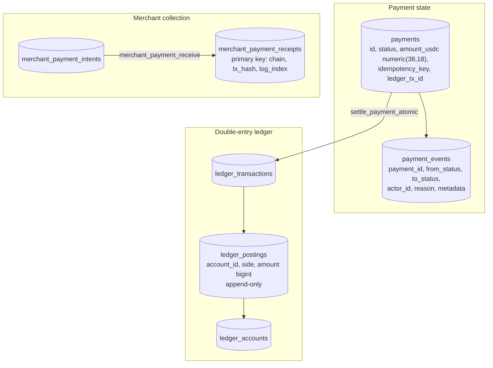

# Financial Ledger, Settlement and Reconciliation Architecture

> **Status, 22 October 2026.** The ledger schema, atomic settlement function and reconciliation views are **IMPLEMENTED and TESTED**. Live on-chain settlement is **switched off** in production. This document records what the database already guarantees, the gaps that must close before live settlement, and the requirements every new money path must meet. Every function, view and column named here was checked against the application's migrations on 22 October 2026. Companion: [Ledger Reconciliation & Invariant Checks](RECONCILIATION.md).

---

## 1. Model

Payment statuses: `pending_signature`, `pending_review`, `settled`, `refunded`, `expired`, `blocked`.

---

## 2. What the database already guarantees

| Guarantee | Mechanism (migration) |
| :--- | :--- |
| Every ledger transaction balances | `ledger_post` sums debits and credits per transaction and raises an exception if they differ, or if there are fewer than two postings (0009) |
| Postings are never edited or deleted | A trigger on `ledger_postings` rejects every `UPDATE` and `DELETE` (0009) |
| Exact amounts in the ledger | `ledger_postings.amount` is `bigint` minor units, `> 0` (0009) |
| One settlement per payment, even under concurrency | `settle_payment_atomic(p_payment_id, p_payer, p_tx_hash, p_chain, p_ledger_tx_id, p_memo, p_postings, p_actor_id)` locks the payment row, settles it and posts its ledger entry in one transaction, and reports a replay instead of posting twice (0009) |
| One credit per on-chain transfer | Receipts' primary key `(chain, tx_hash, log_index)`; `merchant_payment_receive` validates the amount and time window, records the receipt, posts a balanced journal and writes the webhook outbox row, all in one transaction (0040) |
| Balances are derived, never stored | `ledger_account_balance` sums postings |
| Defects are visible | Views `ledger_imbalance` (must be 0) and `payments_missing_ledger` (must be empty), plus reconciliation queries for settled-without-ledger, completed-without-evidence, stale in-flight and awaiting-review |
| A status change cannot overwrite a newer one | Status updates are conditional on the expected current status |
| Webhook replays are ignored | Provider events are recorded once in a webhook-events table; the handler fails closed if that store is unavailable |

---

## 3. Gaps to close before live settlement

These are durability and correctness gaps, not externally exploitable vulnerabilities. Each was confirmed in the source at `7a392b87` and re-checked on 22 October 2026 against every open branch: **none is resolved yet.** Backlog references are to the [implementation backlog](IMPLEMENTATION-BACKLOG-2026-10.md).

| # | Affected module | Risk | Remediation | Acceptance test | Status |
| :--- | :--- | :--- | :--- | :--- | :--- |
| **G1** | `apps/web/src/lib/paymentsDb.ts`: `insertPayment()` and `transitionPayment()` write the `payments` row and its `payment_events` row as two separate statements | A crash between them leaves a payment, or a status change, without its audit event | Write both in one transaction: a SQL function, or `BEGIN … COMMIT` on the `pg` driver | Inject a failure after the first write (a test double that throws on the event insert) and assert that neither row exists afterwards | Open (B1) |
| **G2** | `paymentsDb.ts` `optional()`: when the database is configured but a payments table or function is **missing**, the function returns `null` and the caller keeps its in-memory path | A skipped migration in production produces per-instance payment state | In production, a missing table or function is an error (HTTP 503), plus a boot-time schema assertion | With `FURLPAY_ENV=production` and the `payments` table absent, a payment request returns 503 and no in-memory record exists | Open (B2) |
| **G3** | `apps/web/src/lib/storeDb.ts` `saveAccount()`: whole-account write-back (user row upserted, child rows replaced through `save_account_children`) | Two instances changing different parts of one account can overwrite each other: a lost update | Targeted row updates for each mutation; a `version` column checked on every remaining whole-object write | Two concurrent writers change different fields of the same account; both changes persist, or the second gets a conflict, never a silent overwrite | Open (B3) |
| **G4** | `storeDb.ts` hydration: `numeric(38,18)` amounts and other `numeric` columns converted with JavaScript `Number()` | Precision beyond about 15–17 significant digits is lost on read | Select as `::text`; keep strings or `BigInt` minor units end to end | Store `123456789.123456789012345678`, load it, save it, reload it: byte-identical | Open (B4) |
| **G5** | `paymentsDb.ts` `ledgerBalance()`: the `bigint` result of `ledger_account_balance` is read into a JavaScript `Number` | Exact only up to 2^53 minor units (about 9 billion USDC at 6 decimals) | Read as text, parse into `BigInt` | A balance of 2^53 + 1 minor units is returned exactly | Open (B4) |
| **G6** | Payment paths other than merchant collection have no outbox. Merchant collection already writes `merchant_payment_outbox` inside `merchant_payment_receive` | An event from those paths can be lost if the process stops after commit and before dispatch | Write an outbox row in the same transaction as each state change; a worker dispatches and retries (see [AWS Data and Event Infrastructure](../aws/AWS-DATA-EVENT-INFRASTRUCTURE.md)) | Kill the process after commit and before dispatch; on restart the event is delivered exactly once to a receiver that deduplicates on the event id | Open (B5) |

## 3a. Refunds and reversals

- **Merchant refunds** (migration 0045): FurlPay reserves and accounts for a refund; the custody provider that controls the collection addresses sends it. A refund is completed only from the chain's own record of that transfer, never from a claim. Approval and completion are separate, recorded operator actions (**IMPLEMENTED**).
- **Ledger reversals** are new, opposite postings. A posting is never edited.
- **Payments**: `refunded` is a terminal status with its own transaction hash and timestamp, reached only through a conditional transition.

## 3b. Database failover and crash recovery

| Event | Effect | Why it is safe |
| :--- | :--- | :--- |
| Writer failover mid-transaction | The transaction rolls back; the client sees an error | Nothing partial is committed; callers retry |
| Retry of a settlement | `settle_payment_atomic` reports `already` | Row lock plus status check |
| Retry of a merchant credit | The receipts primary key rejects the duplicate | `(chain, tx_hash, log_index)` |
| Retry of a status change | The conditional update matches zero rows | `status=eq.<expected>` filter |
| Crash after on-chain finality, before the database write | The next scan re-reads the chain at `finalized` and records it | Idempotent receipt function |

## 4. Requirements for every money path

1. **Atomic state transitions.** A status change, its audit event and its ledger postings commit together or not at all.
2. **Append-only postings.** Corrections are new, reversing transactions, never edits.
3. **Balanced entries.** Enforced by the database (`ledger_post`), not by the caller.
4. **Concurrency control.** Row locks for settlement; conditional updates (`status=eq.<expected>`) for transitions; a version column wherever a whole object is written back.
5. **Database-enforced idempotency.** A unique key for every external identifier: idempotency key, transaction hash and log index, provider event id.
6. **Exact money.** `bigint` minor units in the ledger; `numeric` read as text; no floating point anywhere money is computed.
7. **Fail closed.** No in-memory substitute for a durable store in production. An unavailable store is a 503.
8. **Chain evidence before credit.** Credit only from a transaction read at `finalized` commitment, re-read by signature or hash before the write.
9. **Reconciliation.** Scheduled jobs compare the ledger with chain evidence and raise alerts for each defect class in §2.
10. **Tamper-evident evidence (PLANNED).** Write evidence bundles (transaction hash, finality reference, screening decision, ledger transaction id, hash of the request) to an S3 bucket with Object Lock.

---

## 5. When chain and database disagree

| Situation | Resolution |
| :--- | :--- |
| Finalized on chain, not recorded (crash after finality) | The next scan re-reads the chain at finalized commitment and records it; receipts are idempotent |
| Recorded, but the transaction cannot be found on chain | Raised as a reconciliation alert; never auto-reversed. An operator investigates with the chain evidence |
| Paid outside the payment window, or by a screened sender | Held for review; an operator records the decision; funds move only through verified chain evidence |
| Settled payment with no ledger transaction | `payments_missing_ledger` alert; corrected by posting, never by editing |
| Ledger imbalance | `ledger_imbalance` alert; this indicates a defect already written to the books. Requirement (not yet automated): further settlement pauses until it is resolved |
