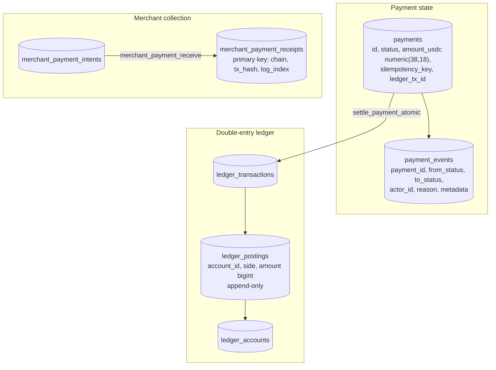

# Financial Ledger, Settlement and Reconciliation Architecture

> **Status, 22 October 2026.** The ledger schema, atomic settlement function and reconciliation views are **IMPLEMENTED and TESTED**. Live on-chain settlement is **switched off** in production. This document records what the database already guarantees, the gaps that must close before live settlement, and the requirements every new money path must meet. Every function, view and column named here was checked against the application's migrations on 22 October 2026. Companion: [Ledger Reconciliation & Invariant Checks](RECONCILIATION.md).

---

## 1. Model

Payment statuses: `pending_signature`, `pending_review`, `settled`, `refunded`, `expired`, `blocked`.

---

## 2. What the database already guarantees

| Guarantee | Mechanism (migration) |
| :--- | :--- |
| Every ledger transaction balances | `ledger_post` sums debits and credits per transaction and raises an exception if they differ, or if there are fewer than two postings (0009) |
| Postings are never edited or deleted | A trigger on `ledger_postings` rejects every `UPDATE` and `DELETE` (0009) |
| Exact amounts in the ledger | `ledger_postings.amount` is `bigint` minor units, `> 0` (0009) |
| One settlement per payment, even under concurrency | `settle_payment_atomic(p_payment_id, p_payer, p_tx_hash, p_chain, p_ledger_tx_id, p_memo, p_postings, p_actor_id)` locks the payment row, settles it and posts its ledger entry in one transaction, and reports a replay instead of posting twice (0009) |
| One credit per on-chain transfer | Receipts' primary key `(chain, tx_hash, log_index)`; `merchant_payment_receive` validates the amount and time window, records the receipt, posts a balanced journal and writes the webhook outbox row, all in one transaction (0040) |
| Balances are derived, never stored | `ledger_account_balance` sums postings |
| Defects are visible | Views `ledger_imbalance` (must be 0) and `payments_missing_ledger` (must be empty), plus reconciliation queries for settled-without-ledger, completed-without-evidence, stale in-flight and awaiting-review |
| A status change cannot overwrite a newer one | Status updates are conditional on the expected current status |
| Webhook replays are ignored | Provider events are recorded once in a webhook-events table; the handler fails closed if that store is unavailable |

---

## 3. Gaps to close before live settlement

These are durability and correctness gaps, ranked. None is an externally exploitable vulnerability. Each is tracked in the [implementation backlog](IMPLEMENTATION-BACKLOG-2026-10.md).

| # | Gap | Consequence | Requirement |
| :--- | :--- | :--- | :--- |
| G1 | Creating a payment, and non-settlement status changes, write the payment row and its audit event as **two separate statements** | A crash between them leaves a payment or status change without its audit event | One transaction: a SQL function, or `BEGIN … COMMIT` once the app is on the `pg` driver |
| G2 | When the database is configured but a payments migration is **missing**, the payments module returns "not durable" and the caller keeps its in-memory path | Per-instance state in production if a migration is skipped | Production fails closed (HTTP 503) on a missing table or function; a startup check asserts the schema |
| G3 | Account persistence writes back **whole accounts** (user row plus replaced child rows) | Two instances updating different parts of one account can overwrite each other (lost update) | Targeted row updates; a `version` column with optimistic concurrency where whole-object writes remain |
| G4 | Account balances stored as `numeric(38,18)` are read into JavaScript `Number` | Precision beyond about 15–17 significant digits is lost on read | Read as text (`::text`) and keep as strings or `BigInt` minor units; never round-trip money through `Number` |
| G5 | `ledger_account_balance` returns a `bigint`, which is read into a JavaScript `Number` | Exact only up to 2^53 minor units (about 9 billion USDC at 6 decimals) | Read as text and parse into `BigInt` |
| G6 | Merchant collection already writes its webhook outbox row in the same transaction as the credit (`merchant_payment_outbox`, inserted by `merchant_payment_receive`). Other payment paths have no outbox | An event from those paths can be lost if the process stops after commit and before dispatch | Extend the same pattern to every money path (see [AWS Data and Event Infrastructure](../aws/AWS-DATA-EVENT-INFRASTRUCTURE.md)) |

---

## 4. Requirements for every money path

1. **Atomic state transitions.** A status change, its audit event and its ledger postings commit together or not at all.
2. **Append-only postings.** Corrections are new, reversing transactions, never edits.
3. **Balanced entries.** Enforced by the database (`ledger_post`), not by the caller.
4. **Concurrency control.** Row locks for settlement; conditional updates (`status=eq.<expected>`) for transitions; a version column wherever a whole object is written back.
5. **Database-enforced idempotency.** A unique key for every external identifier: idempotency key, transaction hash and log index, provider event id.
6. **Exact money.** `bigint` minor units in the ledger; `numeric` read as text; no floating point anywhere money is computed.
7. **Fail closed.** No in-memory substitute for a durable store in production. An unavailable store is a 503.
8. **Chain evidence before credit.** Credit only from a transaction read at `finalized` commitment, re-read by signature or hash before the write.
9. **Reconciliation.** Scheduled jobs compare the ledger with chain evidence and raise alerts for each defect class in §2.
10. **Tamper-evident evidence (PLANNED).** Write evidence bundles (transaction hash, finality reference, screening decision, ledger transaction id, hash of the request) to an S3 bucket with Object Lock.

---

## 5. When chain and database disagree

| Situation | Resolution |
| :--- | :--- |
| Finalized on chain, not recorded (crash after finality) | The next scan re-reads the chain at finalized commitment and records it; receipts are idempotent |
| Recorded, but the transaction cannot be found on chain | Raised as a reconciliation alert; never auto-reversed. An operator investigates with the chain evidence |
| Paid outside the payment window, or by a screened sender | Held for review; an operator records the decision; funds move only through verified chain evidence |
| Settled payment with no ledger transaction | `payments_missing_ledger` alert; corrected by posting, never by editing |
| Ledger imbalance | `ledger_imbalance` alert; this indicates a defect already written to the books. Requirement (not yet automated): further settlement pauses until it is resolved |
