# Solana Alpenglow Integration and Finality Architecture

> **Status, 22 October 2026.** Alpenglow is **LIVE on Solana mainnet** (activated 21 October 2026). FurlPay's Solana payment path already credits only at `finalized` commitment (**IMPLEMENTED**). Consensus detection, Solana chain health and credit-latency measurement are **IMPLEMENTED and TESTED on a feature branch, not merged or deployed**. Status labels are defined in the [enterprise architecture](ENTERPRISE-ARCHITECTURE-2026-2027.md).

---

## 1. What changed on 21 October 2026

| Fact | Value | Source |
| :--- | :--- | :--- |
| Activation | Epoch 1064, Wednesday 21 October 2026, about 13:36 UTC | solana.com |
| Feature account `A1pengvuM6JEcyNuTnMqepBKhwHE3N6PmUrdATGawhJS` | Activated at slot **459,648,000**, the first slot of epoch 1064 (1064 × 432,000) | Read from mainnet, 22 October 2026 |
| Last TowerBFT block (the Alpenglow genesis block) | Slot **459,652,999**, certified by 446 of 654 validators | solana.com; `getAgGenesisCert` on mainnet |
| First Alpenglow slot | **459,653,000** | solana.com |
| Validator client | Agave v4.3.2 (or the matching Jito and Harmonic builds); Firedancer and Frankendancer are not supported | solana.com |
| Execution | Unchanged: "the SVM, transactions, programs, and fees stay the same" | solana.com |

The published Agave schedule had expected the feature gate to open on 28 September 2026. It activated three weeks later. This is why FurlPay's code never applies Alpenglow timing on a date (§6).

---

## 2. TowerBFT to Votor

| | TowerBFT (until 21 Oct 2026) | Alpenglow / Votor (from 21 Oct 2026) |
| :--- | :--- | :--- |
| Votes | Ordinary transactions inside blocks | Sent directly between validators, collected in a separate structure (Pool); certificates recorded in block footers |
| Finality | About 12.8 s (32 slots at about 400 ms) | Target about 150 ms: an expectation, not a constant |
| Thresholds | Two-thirds supermajority | **Fast path:** a block finalizes if at least 80% of stake notarizes it in the first round. **Slow path:** otherwise a second round with 60% thresholds for notarization, finalization or skip |
| Fault tolerance | — | "Tolerates 20% of adversarial stake plus 20% of offline stake" |
| `confirmed` vs `finalized` | Different states (optimistic vs rooted) | **The same state**; `confirmed` will be deprecated in a later release |
| Clock sysvar | Stake-weighted median of vote timestamps | Set by the leader within `[parent_timestamp, parent_timestamp + 2 × elapsed slot duration]`; still monotonic, once per slot, a coarse clock |
| Ticks / Proof of History pacing | Ticks in the shred stream | Leaders no longer emit ticks; completeness comes from block footer and metadata |
| Banks per slot | One | Rarely more than one candidate bank (under 1% of slots expected), tagged with `bank_id` |

The block-propagation change (Rotor) is a later phase and is not scheduled.

---

## 3. Consensus finality is not payment latency

```mermaid
flowchart LR
    A["Payment intent"] --> B["Authentication<br/>passkey or API key"]
    B --> C["Policy evaluation<br/>limits, mandates"]
    C --> D["Compliance<br/>screening"]
    D --> E["Wallet signing<br/>device, MPC or KMS"]
    E --> F["Solana RPC<br/>submit with failover"]
    F --> G["Finality verification<br/>finalized commitment"]
    G --> H["PostgreSQL ledger<br/>one transaction"]
    H --> I["Audit evidence"]
    I --> J["Merchant webhook<br/>signed, retried"]
```

What a payer experiences is the sum of every box. Alpenglow shortens only box G, from about 12.8 s to a target of about 150 ms. The rest is FurlPay's own work and must be measured:

- **Credit latency, measured.** On the feature branch the operations console reports p50, p95 and p99 per chain. The figure runs from the block time of the payer's transaction to the moment FurlPay recorded the receipt. Block times have one-second resolution, so sub-second values cannot be shown from this data, and none are claimed.
- **Submission-to-finality.** The settlement package's `timings()` measures `submittedAt → finalizedAt` for payments FurlPay submits. Production samples will be published once collected.

**No document, deck or email may state that a FurlPay payment completes in 150 ms.** The accurate statement is: "Solana's consensus targets about 150 ms finality; FurlPay credits at finalized commitment and publishes measured end-to-end latency."

---

## 4. Commitment levels in FurlPay

| Code path | Commitment | Under Alpenglow |
| :--- | :--- | :--- |
| Merchant Solana payment scan (`getSignaturesForAddress`, `getTransaction`) | `finalized` | Unchanged and correct; arrives sooner |
| Merchant scan start slot | `getSlot` at `finalized` | Unchanged |
| Balance displays and lookups | `confirmed` | Now final as well; may move to `finalized` before `confirmed` is deprecated |
| Explorer-style transaction lookup | `confirmed`, with `searchTransactionHistory` status | Unchanged |

Triton One's guidance, followed here: move to `finalized` only once Alpenglow is live, which it now is. Before activation, `finalized` would have cost 12.8 s per read.

The deposit policy for Solana records a nominal depth of 31 confirmations, which is TowerBFT's 32-slot root. Crediting is decided by commitment level, not by counting confirmations, so the depth is not used as a timer.

---

## 5. Streams, `bank_id` and cross-provider reconciliation

FurlPay does not consume Geyser or Yellowstone gRPC streams today; Solana payments are read over JSON-RPC. If streaming is adopted (**RESEARCH**), these rules apply from the first line of code:

1. **Buffer per `(slot, bank_id)`, never per slot.** Keep the candidate that reaches confirmed; discard the rest. Handle `UpdateParent` callbacks for abandoned banks. Yellowstone v16.0.0-rc10+solana.4.3.0 and later do this buffering.
2. **`bank_id` is node-local.** "The number means something inside one connection and nothing across connections." Never compare it between providers.
3. **Reconcile across providers by blockhash only.** Buffer per connection, then merge on blockhash.
4. **Deduplicate payments by transaction signature,** within a single database transaction that also records the credit. FurlPay's receipts table already has the primary key `(chain, tx_hash, log_index)`, so a replayed or doubly-delivered transaction cannot be credited twice.
5. **Vote accounts read as `jsonParsed` gain an optional `blsPubkeyCompressed` field,** which can be null. Parsers must accept unknown fields.

---

## 6. Detecting the consensus from the chain

On the feature branch, `lib/chains/solanaConsensus.ts` reports **Alpenglow** only when both of these independent reads agree:

1. The feature account `A1pengvu…` is owned by `Feature111…` and decodes, as bincode `Option<u64>`, to an activation slot.
2. `getAgGenesisCert` returns a certificate (it returns null under TowerBFT; "method not found" means Agave older than 4.3).

Anything else resolves to **unknown**, which plans against TowerBFT timing. When the gate is active but no certificate exists yet, the switch is still in progress: blocks then carry only votes and nothing should be treated as final on Alpenglow timing. A node that lacks `getAgGenesisCert` is not placed in failover cooldown, because a missing method is an answer, not an outage.

The settlement package follows the same rule: **a date is a plan, a feature gate is an event.** Unknown resolves to the slower number, because being late costs a support ticket and being early costs money.

---

## 7. Failure modes and recovery

| Failure | Behaviour |
| :--- | :--- |
| RPC endpoint down, slow or returning malformed data | Ordered failover to the next endpoint; each endpoint must first prove it serves mainnet (genesis hash) before any answer is used. Failed endpoints cool down for 30 s. |
| Endpoint on the wrong cluster | Never used again in that process; reported to operators. |
| Head stale for more than 2 minutes | Crediting stops in practice; an alert is raised (Solana included on the feature branch). |
| Transaction not found yet | Not an error: the intent stays `awaiting_payment` or `confirming` until it expires. |
| Payment outside the intent's time window, or from a sanctioned sender | Held for operator review; never auto-credited. |
| Duplicate delivery of the same transaction | Rejected by the receipts primary key; the ledger is unchanged. |
| Crash between on-chain finality and the database write | Recovered by the next scan: chain evidence is re-read at finalized commitment and the write is idempotent. |
| Timeouts | JSON-RPC calls have an 8 s timeout and a 2 MB response cap. Post-Alpenglow, waits built around 12.8 s finality can be shortened, but only for code paths that read `finalized`. |

---

## 8. Analytics after vote removal

Votes were a majority of Solana's transaction count (published estimates range from just over half to about three-quarters). Headline TPS fell sharply on 21 October 2026 because votes left blocks, not because user activity fell. FurlPay's on-chain analytics count token transfers per mint rather than network-wide TPS, so they are unaffected. Any network TPS chart must be re-baselined and annotated at epoch 1064.

---

## Sources

- [solana.com/upgrades/alpenglow](https://solana.com/upgrades/alpenglow) and [Anza: Alpenglow](https://docs.anza.xyz/consensus/alpenglow); SIMD-0326 (consensus), SIMD-0384 (migration), SIMD-0387 (BLS keys in vote accounts).
- [Triton One: Alpenglow and your Triton stack](https://blog.triton.one/alpenglow-and-your-triton-stack-what-to-update-before-mainnet/).
- Mainnet JSON-RPC, 22 October 2026: `getAccountInfo` on the feature account, `getAgGenesisCert`, `getVersion` (`solana-core` 4.3.2), `getEpochInfo` (epoch 1064).
