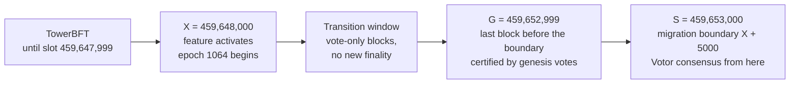

# Solana Alpenglow Integration and Finality Architecture

> **Status, 22 October 2026.** Alpenglow's Votor consensus is **LIVE on Solana mainnet** (activated 21 October 2026); Rotor is not yet scheduled. FurlPay's Solana payment path already credits only at `finalized` commitment (**IMPLEMENTED**). Consensus detection, Solana chain health and credit-latency measurement are **IMPLEMENTED and TESTED on a feature branch, not merged or deployed**. Status labels are defined in the [enterprise architecture](ENTERPRISE-ARCHITECTURE-2026-2027.md).

---

## 1. What changed on 21 October 2026

| Fact | Value | Source |
| :--- | :--- | :--- |
| Activation | Epoch 1064, Wednesday 21 October 2026, about 13:36 UTC | solana.com |
| Feature activation, `X` | Slot **459,648,000**, the first slot of epoch 1064 (1064 × 432,000). The feature account `A1pengvuM6JEcyNuTnMqepBKhwHE3N6PmUrdATGawhJS` records this slot | Read from mainnet, 22 October 2026 |
| Migration boundary, `S = X + 5000` | Slot **459,653,000**. SIMD-0384 places the boundary 5,000 slots after activation "to avoid the beginning of an epoch". Alpenglow consensus runs from here | SIMD-0384; solana.com |
| Alpenglow genesis block, `G` | Slot **459,652,999**: the most recent block before the boundary, certified by genesis votes from 446 of 654 validators (the threshold is at least 82% of stake). TowerBFT is disabled for every slot after `G` | SIMD-0384; `getAgGenesisCert` on mainnet |
| Validator client | Agave v4.3.2 (or the matching Jito and Harmonic builds); Firedancer and Frankendancer are not supported | solana.com |
| Execution | Unchanged: "the SVM, transactions, programs, and fees stay the same" | solana.com |

**The three slot numbers are not interchangeable.** `X` is when the switch began, `S` is the boundary it was scheduled around, and `G` is the block it was anchored to. Sources that quote "slot 459,653,000" as the activation slot mean the boundary, not the feature activation.

**The transition window (`X` to the genesis certificate).** SIMD-0384 has validators pack only simple vote transactions, stop sending optimistic-confirmation updates to RPC services, and stop rooting under TowerBFT. For roughly 5,000 slots (about half an hour at 400 ms per slot), **nothing new became final and user transactions were not included.** Any payment flow open during that window simply waited. FurlPay treats the gate-active-but-no-certificate state as "unknown" for exactly this reason (§7).

The published Agave schedule had expected the feature gate to open on 28 September 2026. It activated three weeks later. This is why FurlPay's code never applies Alpenglow timing on a date (§7).

**Votor is live; Rotor is not.** Alpenglow has two parts. Votor (voting and finality) activated on 21 October 2026. Rotor, which replaces Turbine block propagation, is a later phase with no published activation date.

---

## 2. TowerBFT to Votor

| | TowerBFT (until 21 Oct 2026) | Alpenglow / Votor (from 21 Oct 2026) |
| :--- | :--- | :--- |
| Votes | Ordinary transactions inside blocks | Sent directly between validators, collected in a separate structure (Pool); certificates recorded in block footers |
| Finality | About 12.8 s (32 slots at about 400 ms) | Target about 150 ms: an expectation, not a constant |
| Thresholds | Two-thirds supermajority | **Fast path:** a block finalizes if at least 80% of stake notarizes it in the first round. **Slow path:** otherwise a second round with 60% thresholds for notarization, finalization or skip |
| Fault tolerance | — | "Tolerates 20% of adversarial stake plus 20% of offline stake" |
| `confirmed` vs `finalized` | Different states (optimistic vs rooted) | **The same state**; `confirmed` will be deprecated in a later release |
| Clock sysvar | Stake-weighted median of vote timestamps | Set by the leader within `[parent_timestamp, parent_timestamp + 2 × elapsed slot duration]`; still monotonic, once per slot, a coarse clock |
| Ticks / Proof of History pacing | Ticks in the shred stream | Leaders no longer emit ticks; completeness comes from block footer and metadata |
| Banks per slot | One | Rarely more than one candidate bank (under 1% of slots expected), tagged with `bank_id` |

The block-propagation change (Rotor) is a later phase and is not scheduled.

---

## 3. Observed finality, 22 October 2026

FurlPay measured finality from its own vantage point rather than quoting the target. For 60 seconds it polled a public mainnet endpoint every 250 ms for the `processed`, `confirmed` and `finalized` slots.

| Observation (207 slots, 22 Oct 2026, about 02:14 UTC) | Value |
| :--- | :--- |
| `confirmed` slot equal to `finalized` slot | On every sample |
| `processed` minus `finalized` | 0–1 slots |
| Time from a slot first appearing at `processed` to it being `finalized`: p50 / p95 / p99 / max | **263 / 519 / 530 / 547 ms** |

This is an upper bound on protocol finality, not a measurement of it. It includes the 250 ms polling interval and the provider's own propagation. It is consistent with a ~150 ms protocol target plus that overhead. It is a single 60-second sample from one provider, so it is a data point, not a service level.

## 4. Consensus finality is not payment latency

```mermaid
flowchart LR
    A["Payment intent"] --> B["Authentication<br/>passkey or API key"]
    B --> C["Policy evaluation<br/>limits, mandates"]
    C --> D["Compliance<br/>screening"]
    D --> E["Wallet signing<br/>device, MPC or KMS"]
    E --> F["Solana RPC<br/>submit with failover"]
    F --> G["Finality verification<br/>finalized commitment"]
    G --> H["PostgreSQL ledger<br/>one transaction"]
    H --> I["Audit evidence"]
    I --> J["Merchant webhook<br/>signed, retried"]
```

What a payer experiences is the sum of every box. Alpenglow shortens only box G, from about 12.8 s to a target of about 150 ms. The rest is FurlPay's own work and must be measured:

- **Credit latency, measured.** On the feature branch the operations console reports p50, p95 and p99 per chain. The figure runs from the block time of the payer's transaction to the moment FurlPay recorded the receipt. Block times have one-second resolution, so sub-second values cannot be shown from this data, and none are claimed.
- **Submission-to-finality.** The settlement package's `timings()` measures `submittedAt → finalizedAt` for payments FurlPay submits. Production samples will be published once collected.

**No document, deck or email may state that a FurlPay payment completes in 150 ms.** The accurate statement is: "Solana's consensus targets about 150 ms finality; FurlPay credits at finalized commitment and publishes measured end-to-end latency."

---

## 5. Commitment levels in FurlPay

| Code path | Commitment | Under Alpenglow |
| :--- | :--- | :--- |
| Merchant Solana payment scan (`getSignaturesForAddress`, `getTransaction`) | `finalized` | Unchanged and correct; arrives sooner |
| Merchant scan start slot | `getSlot` at `finalized` | Unchanged |
| Balance displays and lookups | `confirmed` | Now final as well; may move to `finalized` before `confirmed` is deprecated |
| Explorer-style transaction lookup | `confirmed`, with `searchTransactionHistory` status | Unchanged |

Triton One's guidance, followed here: move to `finalized` only once Alpenglow is live, which it now is. Before activation, `finalized` would have cost 12.8 s per read.

The deposit policy for Solana records a nominal depth of 31 confirmations, which is TowerBFT's 32-slot root. Crediting is decided by commitment level, not by counting confirmations, so the depth is not used as a timer.

---

## 6. Streams, `bank_id` and cross-provider reconciliation

FurlPay does not consume Geyser or Yellowstone gRPC streams today; Solana payments are read over JSON-RPC. If streaming is adopted (**RESEARCH**), these rules apply from the first line of code:

1. **Buffer per `(slot, bank_id)`, never per slot.** Keep the candidate that reaches confirmed; discard the rest. Handle `UpdateParent` callbacks for abandoned banks. Yellowstone v16.0.0-rc10+solana.4.3.0 and later do this buffering.
2. **`bank_id` is node-local.** "The number means something inside one connection and nothing across connections." Never compare it between providers.
3. **Reconcile across providers by blockhash only.** Buffer per connection, then merge on blockhash.
4. **Deduplicate payments by transaction signature,** within a single database transaction that also records the credit. FurlPay's receipts table already has the primary key `(chain, tx_hash, log_index)`, so a replayed or doubly-delivered transaction cannot be credited twice.
5. **Vote accounts read as `jsonParsed` gain an optional `blsPubkeyCompressed` field,** which can be null. Parsers must accept unknown fields.

---

## 7. Detecting the consensus from the chain

On the feature branch, `lib/chains/solanaConsensus.ts` reports **Alpenglow** only when both of these independent reads agree:

1. The feature account `A1pengvu…` is owned by `Feature111…` and decodes, as bincode `Option<u64>`, to an activation slot.
2. `getAgGenesisCert` returns a certificate (it returns null under TowerBFT; "method not found" means Agave older than 4.3).

Anything else resolves to **unknown**, which plans against TowerBFT timing. When the gate is active but no certificate exists yet, the switch is still in progress: blocks then carry only votes and nothing should be treated as final on Alpenglow timing. A node that lacks `getAgGenesisCert` is not placed in failover cooldown, because a missing method is an answer, not an outage.

The settlement package follows the same rule: **a date is a plan, a feature gate is an event.** Unknown resolves to the slower number, because being late costs a support ticket and being early costs money.

---

## 8. Deposit verification and USDC settlement

How a Solana merchant payment is verified before it is credited (**IMPLEMENTED**; switched off in production):

1. Each payment intent has a single-use destination and a one-time **reference key**. Solana Pay wallets include the reference; a payer who copies the address does not, so transfers into the destination's USDC token account are matched too.
2. Signatures are listed with `getSignaturesForAddress` at `finalized`, deduplicated, and processed oldest first, starting from the slot recorded when the intent was reserved.
3. Each transaction is re-read with `getTransaction` at `finalized`. It must have succeeded, must carry the signature it was listed under, and must sit in the slot it was listed at.
4. If the reference key ever appears as a **signer**, the transaction is ignored. The reference has no private key, so this indicates a forgery attempt.
5. The amount is the increase in the recipient's balance of the **USDC mint `EPjFWdd5AufqSSqeM2qN1xzybapC8G4wEGGkZwyTDt1v`**, computed from pre- and post-token balances, and it must have 6 decimals. Any other mint or precision is refused.
6. Every sender is screened. A transfer outside the intent's time window, or from a screened sender, is held for review.
7. The credit, receipt, balanced journal and webhook outbox row are written by one database function in one transaction. The receipts key `(chain, tx_hash, log_index)` makes a replay a no-op.

**Transaction submission.** In merchant checkout the payer's wallet submits the transaction, so FurlPay never holds the payer's signature or needs to resubmit. For transactions FurlPay itself submits (platform-paid flows), resubmission is safe only while the transaction's blockhash is valid, and the transaction signature is the idempotency key.

## 9. Failure modes and recovery

| Failure | Behaviour |
| :--- | :--- |
| RPC endpoint down, slow or returning malformed data | Ordered failover to the next endpoint; each endpoint must first prove it serves mainnet (genesis hash) before any answer is used. Failed endpoints cool down for 30 s. |
| Endpoint on the wrong cluster | Never used again in that process; reported to operators. |
| Head stale for more than 2 minutes | Crediting stops in practice; an alert is raised (Solana included on the feature branch). |
| Transaction not found yet | Not an error: the intent stays `awaiting_payment` or `confirming` until it expires. |
| Payment outside the intent's time window, or from a sanctioned sender | Held for operator review; never auto-credited. |
| Duplicate delivery of the same transaction | Rejected by the receipts primary key; the ledger is unchanged. |
| Crash between on-chain finality and the database write | Recovered by the next scan: chain evidence is re-read at finalized commitment and the write is idempotent. |
| Timeouts | JSON-RPC calls have an 8 s timeout and a 2 MB response cap. Post-Alpenglow, waits built around 12.8 s finality can be shortened, but only for code paths that read `finalized`. |

---

## 10. Analytics after vote removal

Votes were a majority of Solana's transaction count (published estimates range from just over half to about three-quarters). Headline TPS fell sharply on 21 October 2026 because votes left blocks, not because user activity fell. FurlPay's on-chain analytics count token transfers per mint rather than network-wide TPS, so they are unaffected. Any network TPS chart must be re-baselined and annotated at epoch 1064.

---

## Sources

- [solana.com/upgrades/alpenglow](https://solana.com/upgrades/alpenglow) and [Anza: Alpenglow](https://docs.anza.xyz/consensus/alpenglow); SIMD-0326 (consensus), [SIMD-0384 (migration)](https://github.com/solana-foundation/solana-improvement-documents/blob/main/proposals/0384-alpenglow-migration.md), SIMD-0387 (BLS keys in vote accounts).
- [Triton One: Alpenglow and your Triton stack](https://blog.triton.one/alpenglow-and-your-triton-stack-what-to-update-before-mainnet/).
- Finality observation: `getSlot` at `processed`, `confirmed` and `finalized`, polled every 250 ms for 60 s on a public mainnet endpoint, 22 October 2026.
- Mainnet JSON-RPC, 22 October 2026: `getAccountInfo` on the feature account, `getAgGenesisCert`, `getVersion` (`solana-core` 4.3.2), `getEpochInfo` (epoch 1064).
