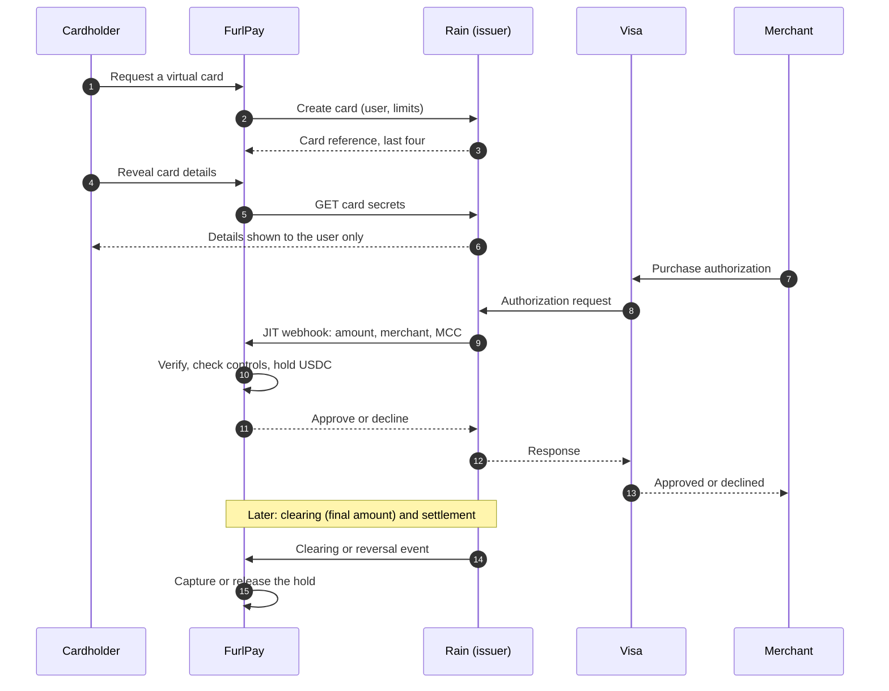

# Virtual Card JIT Rails: How FurlPay Cards Will Work

> **Status, 15 October 2026: plan, not live.** Card issuing is designed and
> switched off (`CARD_ISSUING_LIVE` carries an `unimplemented` reason). No card
> issuer is contracted. Rain is the design target. Anything marked
> **UNVERIFIED** depends on Rain's partner documentation, which is not public,
> and must be confirmed in their sandbox before it is built. Latency figures
> are targets, not measurements.

**Related:** [Verified claims](VERIFIED-CLAIMS.md) ·
[USDC payment flow & AWS architecture](../aws/FURLPAY_USDC_PAYMENT_FLOW_AND_AWS_ARCHITECTURE.md) ·
[AWS engagement brief](../aws/AWS-ENGAGEMENT-BRIEF.md)

---

## 1. What "JIT" means here

A FurlPay virtual card will hold **no balance of its own**. Every time it is
used, the card issuer asks FurlPay, in real time, whether to approve the
purchase. FurlPay answers yes only if the cardholder's USDC covers it, and in
the same step reserves (holds) that amount so it cannot be spent twice.
This is just-in-time (JIT) authorization: money is committed to a card at the
moment of purchase, not loaded in advance.

For the user, this means one balance. USDC in FurlPay is spendable on the card
anywhere Visa is accepted, and nothing is stranded on a card.

---

## 2. Who does what

| Party | Role |
| :--- | :--- |
| **Cardholder** | A FurlPay user who has passed the issuer's KYC |
| **Merchant and acquirer** | Send the purchase into the card network |
| **Card network (Visa)** | Routes the authorization to the issuer |
| **Issuer: Rain, with its sponsor bank** | Holds the card program, stores card numbers, applies its own blocklists, asks FurlPay to decide, settles with the network |
| **FurlPay (program manager)** | Owns the user, the USDC balance and the ledger. Decides approve or decline. Sets card controls |

Card numbers (PAN), CVCs and PINs stay with the issuer. FurlPay stores only the
issuer's card reference and the last four digits, which keeps FurlPay's PCI DSS
scope small. Card logging is already redacted in the codebase.

---

## 3. The lifecycle

---

## 4. The authorization decision

### 4.1 The time budget

The issuer has to answer the card network quickly, so it gives FurlPay a fixed
window. If FurlPay does not answer in time, the issuer declines. Marqeta, for
example, [declines after three seconds](https://www.marqeta.com/docs/developer-guides/managing-timeouts).
**Rain's window is UNVERIFIED.**

| Step | Target (p99) |
| :--- | :--- |
| Verify the webhook signature and source IP | 5 ms |
| Idempotency lookup by the issuer's authorization reference | 10 ms |
| Load card state and controls | 20 ms |
| Check balance and write the hold atomically | 30 ms |
| Encode and return the decision | 5 ms |
| **Server time, end to end** | **under 300 ms** |

The target leaves most of the issuer's window for network transit and retries.

### 4.2 Decision rules, in order

The first rule that fails declines the purchase, and the reason is recorded.

1. **Authenticity.** The webhook signature verifies over the raw body, and the
   timestamp is fresh. Otherwise decline. **UNVERIFIED:** Rain's signature
   scheme. Until it is known, the adapter refuses every authorization rather
   than verify against a guessed scheme.
2. **Card state.** The card is `active`, not `notActivated`, `locked` or
   `canceled`.
3. **Issuer restrictions.** The merchant category is not on Rain's default
   blocklist. Rain also runs an unpublished dynamic blocklist, so passing this
   check never guarantees approval.
4. **FurlPay card controls.** The merchant category matches the card's lock,
   if it has one, and the amount fits the card's limits. Rain limits are an
   amount per window: `perAuthorization`, `per24HourPeriod`, `per7DayPeriod`,
   `per30DayPeriod`, `perYearPeriod` or `allTime`.
5. **Verification results.** A failed CVC or expiry check from the network
   declines.
6. **Funds.** Available balance means the USDC balance minus open holds. It
   must cover the amount, converted to USD with an FX buffer when the purchase
   is in another currency.
7. **Risk.** Velocity checks and anomaly signals. A risk decline is logged with
   its signal, so support can explain it.

If every rule passes, FurlPay writes the hold and approves. Approval and hold
are a single atomic operation, so two simultaneous purchases cannot both spend
the same dollars.

---

## 5. Holds, clearing and the ledger

Every authorization becomes a **hold** in FurlPay's double-entry ledger, keyed
by the issuer's authorization reference.

| Event | Ledger effect |
| :--- | :--- |
| Authorization approved | Hold the amount; available balance falls |
| Incremental authorization (hotels, car rental) | Increase the existing hold |
| Partial approval | Hold only the approved amount |
| Reversal | Release the hold |
| Clearing | Capture the final amount, which can differ (tips, fuel, hotels); release any difference |
| Hold expiry, no clearing | Release after a category-based window, longer for lodging and car rental |
| Refund | Credit the balance |
| Clearing with no prior authorization (force post) | Capture anyway; a negative balance goes to collections review |

The issuer may deliver the same webhook more than once. A repeat with the same
reference returns the same answer and does not create a second hold.

---

## 6. How card spend is funded and settled

Rain settles card transactions onchain in stablecoins. Two funding models are
possible, and the choice is part of the issuer contract:

- **A. Issuer-held collateral.** USDC that backs card spend sits in an
  account the issuer can draw on, and Rain settles from it. This is the
  closest fit to a stablecoin-native issuer, and the expected default.
- **B. FurlPay-prefunded float.** FurlPay keeps a balance with the issuer and
  tops it up. This is simpler for the issuer, but it ties up FurlPay's own
  capital.

Either way, FurlPay reconciles every day: ledger captures against the
issuer's settlement report, and the issuer's settlement against the onchain
transfers. Any break is investigated before the next settlement.
**UNVERIFIED:** Rain's settlement report format and timing.

---

## 7. When things go wrong

FurlPay fails closed. When in doubt, the purchase is declined, because a wrong
approval spends a customer's money and a wrong decline does not.

| Failure | Behaviour |
| :--- | :--- |
| FurlPay misses the issuer's deadline | The issuer declines (its stand-in rule); FurlPay records the late request |
| Signature invalid or missing | Decline and alert |
| Database or ledger unavailable | Decline; never approve without writing the hold |
| Source IP not on Rain's published list | Logged. Enforcement is opt-in, because Rain adds egress IPs over time |
| Duplicate delivery | Same answer, no second hold |
| Reversal arrives before the authorization is recorded | Stored and applied when the authorization lands |

---

## 8. Travel cards

FurlPay's travel virtual card numbers lock spend to lodging (MCC 7011),
airlines (4511) and car rental (7512). Rain does not block those categories by
default. It does block **5962** (direct-marketing travel arrangement
services), which is how some online travel agencies bill. A travel card used
on such a site would be declined twice: by FurlPay's lock and by the issuer.
FurlPay checks this at booking, not at checkout.

Hotels and car rentals also authorize more than the final bill and adjust it
later, so these cards depend on incremental authorizations and longer hold
windows (section 5).

**UNVERIFIED:** the API field for merchant-category limits. Rain supports
them, but the field is not in the public SDK's card-creation shape. Until it
is confirmed, the adapter refuses to issue a card with a category lock rather
than issue one that silently ignores it.

---

## 9. Running it on AWS

The authorization path runs separately from the web app, because it has a hard
deadline and a different failure profile.

| Concern | Design |
| :--- | :--- |
| Entry point | ALB with no CDN caching in front of the webhook; optional WAF rule for Rain's egress IPs |
| Compute | A dedicated ECS Fargate service in at least two availability zones, kept warm, with no cold starts |
| Holds | DynamoDB conditional writes for the hot path (balance check and hold in one write), streamed into the Postgres ledger |
| Secrets | The webhook secret and the issuer API key in Secrets Manager, fetched at start-up and rotated |
| Observability | CloudWatch alarms on p99 latency, timeout count, decline rate by reason and reconciliation breaks |

---

## 10. What exists today, and what is missing

**Built and in the codebase:**

- A single gate that blocks every card route in production while
  `CARD_ISSUING_LIVE` is unimplemented.
- A Rain adapter covering the verified API surface: base URL
  `api.raincards.xyz/v1`, `Api-Key` authentication, card states and limit
  windows, card secrets, processor details for wallet provisioning, and
  documented rate limits.
- Rain's published egress IPs, Rain's default merchant restrictions, typed
  authorization requests and decisions, and redaction of card data from logs.

**Missing before launch:**

1. A signed issuer contract and a settlement account.
2. Rain sandbox access, and with it the webhook signature scheme, the
   merchant-category field and the response deadline.
3. The hold logic in the ledger (an authorization ledger is in review) and
   daily reconciliation.
4. The funding model (section 6), agreed with the issuer.
5. PCI DSS scoping, confirmed with a qualified assessor.

---

## 11. Rollout

| Phase | Gate to move on |
| :--- | :--- |
| 0. Contract | Issuer contract signed; sandbox credentials issued |
| 1. Sandbox | Webhook signature verified; every rule in section 4.2 tested against sandbox authorizations |
| 2. Ledger | Holds, captures, reversals and reconciliation pass against sandbox clearing files |
| 3. Internal cards | Team cards with low limits, in production, for at least two settlement cycles with zero reconciliation breaks |
| 4. Travel cards | Category-locked cards for bookings |
| 5. General availability | `unimplemented` removed from `CARD_ISSUING_LIVE` |

No dates are attached, because phase 0 has not happened.
