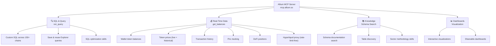
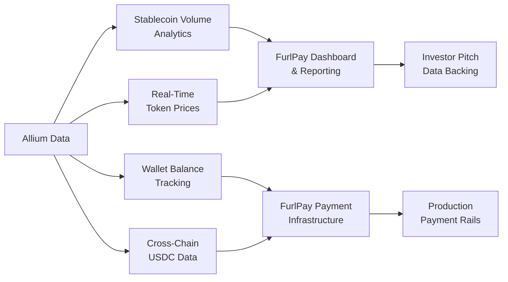

# Allium — API, MCP Server & Partnership Report

**Prepared for:** FurlPay  
**Status:** Partnership active — API keys secured  
**Date:** October 15, 2026

---

## Table of Contents

1. [Company Overview](#1-company-overview)
2. [API Key Setup & Authentication](#2-api-key-setup--authentication)
3. [REST API Endpoints — Full Reference](#3-rest-api-endpoints--full-reference)
4. [MCP Server — Setup & Configuration](#4-mcp-server--setup--configuration)
5. [Stablecoin Data Schemas](#5-stablecoin-data-schemas)
6. [Supported Blockchains](#6-supported-blockchains)
7. [Pricing & Plans](#7-pricing--plans)
8. [Strategic Value for FurlPay](#8-strategic-value-for-furlpay)

---

## 1. Company Overview

| Detail | Information |
|---|---|
| **Company** | Allium Labs |
| **Founded** | 2021 |
| **Founders** | Ethan Chan, Cheng Han Lee, Nick Pai |
| **Total Raised** | $60M+ |
| **Chains Supported** | 80–150+ |
| **Clients** | 150+ enterprise and government |
| **Docs** | [docs.allium.so](https://docs.allium.so) |
| **App** | [app.allium.so](https://app.allium.so) |
| **GitHub** | [github.com/allium-labs](https://github.com/allium-labs) |

### Funding History

| Round | Date | Amount | Lead Investor |
|---|---|---|---|
| Seed | ~2021 | Undisclosed | — |
| Series A | July 2024 | $16.5M | Theory Ventures |
| Series B | June 2026 | $40M | Amplify Partners |

**Key Investors:** Kleiner Perkins, Theory Ventures, Amplify Partners, a16z crypto, Bessemer Venture Partners, Redpoint Ventures

### Major Enterprise Clients

| Client | Use Case |
|---|---|
| **Visa** | Powers the public Visa Onchain Analytics Dashboard — stablecoin growth, volume, economic usage |
| **Phantom** | Real-time wallet balances and asset data for millions of users |
| **Stripe** | Fraud detection models for digital asset payments |
| **Coinbase** | Analytics and on-chain data |
| **Circle** | USDC ecosystem data |
| **Uniswap** | DEX analytics |
| **Grayscale** | Digital asset / ETF research |
| **MoonPay** | On-chain data |
| **Monetary Authority of Singapore** | Regulatory monitoring |

> [!IMPORTANT]
> Allium powers **Visa's official stablecoin analytics** — the same data source referenced in FurlPay's blog post on stablecoin payment volumes. This is a significant partnership for FurlPay to leverage.

---

## 2. API Key Setup & Authentication

### Getting Your API Key

1. Sign up / log in at [app.allium.so](https://app.allium.so/join)
2. Navigate to **Settings → API Keys**
3. Click **Generate** — securely copy the key
4. Only **one active key per user**

### Authentication Header

All REST requests require the `X-API-KEY` header:

```http
GET /api/v1/developer/tokens HTTP/1.1
Host: api.allium.so
X-API-KEY: your-api-key-here
Content-Type: application/json
```

### Base URL

```
https://api.allium.so
```

### Alternative: Agent Payments (x402)

For machine-to-machine AI agent access without a subscription:
```
https://agents.allium.so
```
Uses per-request crypto micropayments via x402/Tempo MPP — directly aligned with FurlPay's x402 implementation.

---

## 3. REST API Endpoints — Full Reference

### Token Prices

| Method | Endpoint | Description |
|---|---|---|
| `POST` | `/api/v1/developer/prices` | Get latest USD token prices |
| `POST` | `/api/v1/developer/prices/history` | Historical time-series pricing |
| `POST` | `/api/v1/developer/prices/stats` | Token price statistics |

Prices are calculated deterministically using on-chain DEX trade activities with Z-score outlier filtering.

### Wallet Balances & Holdings

| Method | Endpoint | Description |
|---|---|---|
| `POST` | `/api/v1/developer/wallet/balances` | Live token balances for wallet addresses |
| `POST` | `/api/v1/developer/wallet/balances/history` | Historical balance iterations (custom timestamps) |
| `POST` | `/api/v1/developer/wallet/pnl` | Realized & unrealized PnL (avg cost-basis) |
| `POST` | `/api/v1/developer/wallet/transactions` | Wallet transaction history |

### Token Discovery

| Method | Endpoint | Description |
|---|---|---|
| `GET` | `/api/v1/developer/tokens` | List all supported tokens |
| `GET` | `/api/v1/developer/tokens/search` | Search by name or symbol |
| `POST` | `/api/v1/developer/tokens/chain-address` | Lookup by chain and contract address |

### Code Example (Node.js)

```javascript
const ALLIUM_API_KEY = process.env.ALLIUM_API_KEY;

async function getWalletBalances(address, chain = 'solana') {
  const response = await fetch(
    'https://api.allium.so/api/v1/developer/wallet/balances',
    {
      method: 'POST',
      headers: {
        'Content-Type': 'application/json',
        'X-API-KEY': ALLIUM_API_KEY,
      },
      body: JSON.stringify({
        addresses: [address],
        chains: [chain],
      }),
    }
  );

  if (!response.ok) {
    throw new Error(`Allium API error: ${response.status}`);
  }

  return response.json();
}

// Get current USDC price
async function getTokenPrice(tokenAddress, chain = 'solana') {
  const response = await fetch(
    'https://api.allium.so/api/v1/developer/prices',
    {
      method: 'POST',
      headers: {
        'Content-Type': 'application/json',
        'X-API-KEY': ALLIUM_API_KEY,
      },
      body: JSON.stringify({
        tokens: [{ chain, address: tokenAddress }],
      }),
    }
  );

  return response.json();
}
```

---

## 4. MCP Server — Setup & Configuration

### Connection Details

| Setting | Value |
|---|---|
| **MCP Server URL** | `https://mcp.allium.so` |
| **Authentication** | OAuth (Allium account) or API key |
| **Deprecated** | `mcp-oauth.allium.so` — do NOT use |

### Option 1: Claude Code / CLI (Recommended for FurlPay)

```bash
npx @allium-labs/mcp install --client claude-code --yes
```

This auto-injects the MCP connector into your workspace.

### Option 2: Claude Desktop

Edit `claude_desktop_config.json`:

- **macOS:** `~/Library/Application Support/Claude/claude_desktop_config.json`
- **Windows:** `%APPDATA%\Claude\claude_desktop_config.json`

Add the Allium MCP server block:

```json
{
  "mcpServers": {
    "allium": {
      "url": "https://mcp.allium.so",
      "transport": "sse"
    }
  }
}
```

### Option 3: Any MCP-Compatible Client

Add `https://mcp.allium.so` as a custom MCP server URL. Authenticate via OAuth when prompted.

**Supported clients:** Claude, Cursor, ChatGPT, VS Code Copilot, Windsurf, and any MCP-compliant host.

### Installing Allium Skills (Optional)

For advanced analytics capabilities within Claude:

```bash
/plugin marketplace add allium-labs/skills
/plugin install allium-analyst@allium-labs
```

### MCP Tool Categories

Once connected, the MCP server exposes these tool groups:



| Tool | Capability |
|---|---|
| **`run_query`** | Execute SQL against any blockchain data across 150+ chains |
| **`get_balances`** | Real-time wallet token balances |
| **`get_prices`** | Live and historical token pricing |
| **`get_transactions`** | Wallet transaction history |
| **`get_pnl`** | Profit & loss tracking |
| **`get_defi_positions`** | DeFi liquidity and staking positions |
| **`search_schemas`** | Discover table structures and data relationships |
| **`get_skill`** | Load methodology skills (e.g., `sql-optimization`, `stablecoins`) |
| **`create_dashboard`** | Build interactive visualizations from query results |

### Example MCP Prompts

Once connected, you can ask your AI agent:

- *"Query the total USDC transfer volume on Solana for the last 30 days"*
- *"Show me the current token balances for wallet `FYatJq...`"*
- *"Analyze the 90-day PnL for this wallet address using Allium"*
- *"What are the top stablecoins by circulating supply today?"*
- *"Run a custom SQL query against stablecoins.metrics.volume_daily"*

---

## 5. Stablecoin Data Schemas

This is the most strategically important dataset for FurlPay. Allium provides institutional-grade stablecoin data that strips out non-economic noise (arbitrage loops, flash loans, bot activity).

### Stablecoin Tables

| Table | Description |
|---|---|
| **`stablecoins.registry.catalog`** | One row per stablecoin product (USDT, USDC, etc.) regardless of chain |
| **`stablecoins.registry.deployments`** | Per-(chain, address) tracking for every stablecoin deployment |
| **`stablecoins.core.transfers`** | Raw, normalized cross-chain stablecoin transfer logs |
| **`stablecoins.core.balances_daily`** | Daily forward-filled stablecoin balances per holder address |
| **`stablecoins.core.supply_change`** | Individual mint and burn events driving supply fluctuations |
| **`stablecoins.core.supply_daily`** | Aggregated daily total, circulating, and adjusted circulating supply |
| **`stablecoins.metrics.volume_daily`** | Pre-filtered daily transfer volumes — organic activity only |

### Example SQL Queries

**Get USDC daily transfer volume on Solana (last 30 days):**

```sql
SELECT
  block_date,
  SUM(amount_usd) AS total_volume_usd,
  COUNT(*) AS transfer_count
FROM stablecoins.core.transfers
WHERE product_id = 'usdc'
  AND chain = 'solana'
  AND block_date >= CURRENT_DATE - INTERVAL '30 days'
GROUP BY block_date
ORDER BY block_date DESC;
```

**Get top stablecoin holders by balance:**

```sql
SELECT
  holder_address,
  product_id,
  chain,
  balance_usd
FROM stablecoins.core.balances_daily
WHERE block_date = CURRENT_DATE - 1
  AND product_id = 'usdc'
ORDER BY balance_usd DESC
LIMIT 100;
```

**Get daily USDC supply changes (mints & burns):**

```sql
SELECT
  block_date,
  SUM(CASE WHEN event_type = 'mint' THEN amount_usd ELSE 0 END) AS minted,
  SUM(CASE WHEN event_type = 'burn' THEN amount_usd ELSE 0 END) AS burned
FROM stablecoins.core.supply_change
WHERE product_id = 'usdc'
  AND block_date >= CURRENT_DATE - INTERVAL '90 days'
GROUP BY block_date
ORDER BY block_date DESC;
```

---

## 6. Supported Blockchains

Allium supports **80–150+ chains** under a unified schema. Key chains for FurlPay:

| Chain | Coverage | FurlPay Relevance |
|---|---|---|
| **Solana** | Full depth from genesis — SPL/Token-2022, DEX trades (Jupiter, Raydium, Orca), staking, NFTs | Primary chain for FURL token and USDC payments |
| **Ethereum** | Full EVM decoded data — transactions, logs, state | EVM cross-chain via Circle CCTP |
| **Base** | Full EVM | Coinbase L2 — potential USDC corridor |
| **Arbitrum** | Full EVM | L2 stablecoin corridor |
| **Optimism** | Full EVM | L2 stablecoin corridor |
| **Polygon** | Full EVM | High-volume payment rails |
| **Bitcoin** | Indexed | Reference data |
| **TON** | Indexed | Telegram-native payments |
| **Hyperliquid** | Rate-limit-free proxy | Orderbook analytics |
| **Aptos** | Indexed | Move-based chains |
| **Sui** | Indexed | Move-based chains |

---

## 7. Pricing & Plans

| Plan | Cost | API Credits | Features |
|---|---|---|---|
| **Free (Developer)** | \$0 | 20,000 credits | Select real-time Developer API endpoints |
| **Enterprise** | Custom pricing | Unlimited | Full APIs + Datastreams (Kafka/PubSub/SNS) + Datashares (Snowflake/BigQuery/S3) + SQL Explorer + dedicated support + custom SLAs |

### Enterprise Data Delivery Options

| Method | Target | Use Case |
|---|---|---|
| **REST APIs** | Application layer | Real-time queries from FurlPay backend |
| **Datastreams** | Kafka, PubSub, SNS | Real-time event streaming |
| **Datashares** | Snowflake, BigQuery, Databricks, S3, GCS | Bulk historical data for analytics |
| **SQL Explorer** | Browser | Ad-hoc queries and dashboard building |

---

## 8. Strategic Value for FurlPay

### Why Allium Matters



### Immediate Use Cases for FurlPay

| Use Case | Allium Capability | FurlPay Integration |
|---|---|---|
| **SOL/USDC price oracle** | Real-time token prices (on-chain DEX-derived) | `solUsdPrice()` sanity check (AGENTS.md rule #8) |
| **Payment volume analytics** | `stablecoins.metrics.volume_daily` | Dashboard showing USDC payment volumes |
| **Wallet balance verification** | `wallet/balances` endpoint | Verify user USDC balances before card authorization |
| **Cross-chain USDC tracking** | `stablecoins.core.transfers` | Monitor Circle CCTP cross-chain settlement |
| **Supply monitoring** | `stablecoins.core.supply_daily` | USDC health monitoring and risk signals |
| **AI agent data access** | MCP server | Claude-powered financial analytics within FurlPay |
| **x402 agent payments** | `agents.allium.so` | FurlPay's x402 agents paying for data per-request |
| **Blog & pitch content** | Visa-grade stablecoin data | Reference Allium/Visa data in pitch deck and blog |

### Competitive Signal

Allium's client list validates FurlPay's data infrastructure approach:
- If **Visa** uses Allium for stablecoin analytics, FurlPay is using the same data source as the world's largest payment network
- If **Phantom** (100M+ downloads) relies on Allium for wallet data, FurlPay is building on production-proven infrastructure
- If **Stripe** uses Allium for fraud detection, FurlPay can reference the same data quality standard

### For the AWS Call with Cyrus

> *"Our on-chain analytics are powered by Allium — the same data provider that powers Visa's stablecoin dashboard and Phantom's wallet infrastructure. Allium gives us institutional-grade, cross-chain USDC data across 150+ blockchains."*

---

## Appendix: Quick Reference

### Environment Variable

```bash
# Add to .env (NOT .env.local)
ALLIUM_API_KEY=your-key-here
```

> [!WARNING]
> Per FurlPay AGENTS.md rule #10: this must NOT have the `NEXT_PUBLIC_` prefix. Register it in `apps/web/src/lib/env.ts` and document in `apps/web/.env.example`.

### Key URLs

| Resource | URL |
|---|---|
| App / API Keys | [app.allium.so](https://app.allium.so) |
| Documentation | [docs.allium.so](https://docs.allium.so) |
| MCP Server | `https://mcp.allium.so` |
| Agent Endpoint | `https://agents.allium.so` |
| REST API Base | `https://api.allium.so` |
| GitHub Skills | [github.com/allium-labs/skills](https://github.com/allium-labs/skills) |
| Visa Dashboard | [onchain.visa.com](https://onchain.visa.com) |

---

*Report compiled on October 15, 2026. Sources: Allium official documentation, Allium blog, public press releases, and API reference.*
