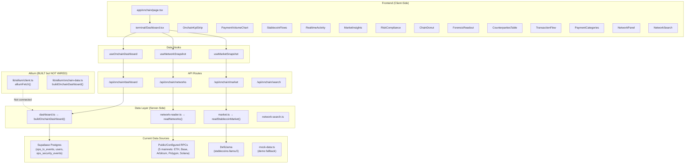
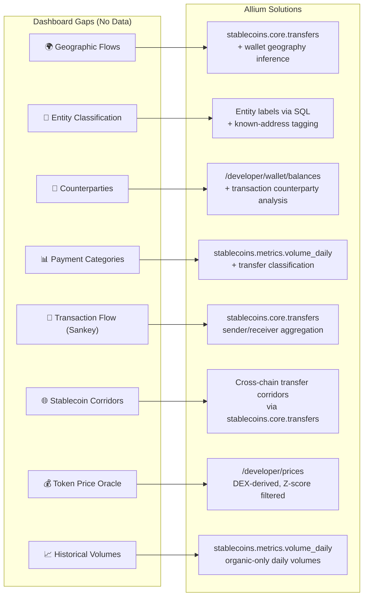
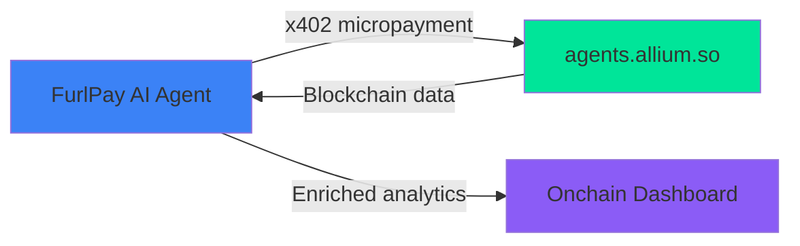
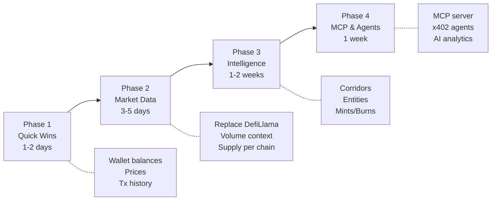

# FurlPay Onchain Intelligence Dashboard — Allium Integration Report

**Prepared for:** FurlPay Engineering  
**Status:** Dashboard live; Allium client built; integration pending  
**Date:** October 15, 2026

---

## Table of Contents

1. [Current Dashboard Architecture](#1-current-dashboard-architecture)
2. [Data Source Inventory — What Exists Today](#2-data-source-inventory--what-exists-today)
3. [Allium Client — Already Built](#3-allium-client--already-built)
4. [Gap Analysis — What Allium Fills](#4-gap-analysis--what-allium-fills)
5. [Integration Plan — Allium → Dashboard](#5-integration-plan--allium--dashboard)
6. [New Panels Unlocked by Allium](#6-new-panels-unlocked-by-allium)
7. [MCP Server Integration for AI Agents](#7-mcp-server-integration-for-ai-agents)
8. [API Endpoint Mapping](#8-api-endpoint-mapping)
9. [SQL Queries for Dashboard Panels](#9-sql-queries-for-dashboard-panels)
10. [Implementation Roadmap](#10-implementation-roadmap)

---

## 1. Current Dashboard Architecture

### Overview

The FurlPay Onchain Intelligence dashboard is a **full-stack, source-aware analytics platform** at [`/onchain`](file:///c:/Users/ashut/OneDrive/Documents/Payment%20App/apps/web/src/app/onchain/page.tsx). It uses a terminal-style dark UI with real-time data polling.

### Architecture Diagram



### File Inventory (56 files)

| Layer | Files | Path |
|---|---|---|
| **Page & layout** | 2 | `app/onchain/page.tsx`, `layout.tsx` |
| **Terminal UI** | 6 | `components/onchain/terminal/` — Dashboard, GlobalFlowMap, MarketPanels, NetworkPanels, ui, useMarketSnapshot |
| **Dashboard components** | 17 | `components/onchain/` — KPI strip, charts, tables, panels, sidebar, header |
| **Data contracts** | 4 | `types.ts`, `mock-data.ts`, `dashboard-contract.ts`, `market-contract.ts`, `network-contract.ts` |
| **Hooks** | 2 | `useOnchainDashboard.ts`, `useNetworkSnapshot.ts` |
| **API routes** | 4 | `api/onchain/dashboard`, `market`, `networks`, `search` |
| **Data layer** | 16 | `lib/onchain/` — dashboard, market, networks, balances, cctp, rpc, solana-usdc, forensics, search |
| **Allium client** | 2 | `lib/allium/client.ts`, `onchain-data.ts` |
| **Tests** | 5 | `lib/onchain/__tests__/` |

---

## 2. Data Source Inventory — What Exists Today

### Source Status Matrix

| Data Source | Provider | Status | What It Powers |
|---|---|---|---|
| **FurlPay Ledger** | Supabase Postgres | ✅ Live (admin-only) | Payment volume, settled transactions, activity feed, security events, registered users |
| **Stablecoin Market Supply** | DefiLlama | ✅ Live | Total stablecoin supply, month-over-month changes, asset rankings |
| **Native USDC Networks** | Public/configured RPCs (5 chains) | ✅ Live | Block heads, USDC supply per chain, recent transfer samples, CCTP bridge events |
| **Allium REST API** | Allium Labs | ⚠️ Client built, not wired | Wallet balances, token prices, transaction history, PnL, custom SQL |
| **Demo Data** | `mock-data.ts` | ✅ Fallback | Full dashboard shape with realistic fake data |

### What the Dashboard Currently Shows

| Section | Data Source | Real Data? |
|---|---|---|
| **KPI Strip** (5 cards) | Ledger: volume + transactions from Supabase RPC `analytics_tx_buckets` | ✅ Yes (2 of 5) |
| | Users, recipients, fees | ❌ Not connected |
| **Payment Volume Chart** | Ledger `analytics_tx_buckets` bucketed by token | ✅ Yes |
| **Stablecoin Market** | DefiLlama circulating supply | ✅ Yes |
| **Chain Ranking** | RPC — head blocks, supply, transfer samples | ✅ Yes |
| **Cross-Chain / CCTP** | RPC — `MessageSent` / `MessageReceived` events | ✅ Yes |
| **Wallet Discovery** | RPC — recent transfer events, senders/receivers | ✅ Yes |
| **Activity Feed** | Supabase `ops_tx_events` | ✅ Yes |
| **Risk Panel** | Supabase `ops_security_events` | ✅ Yes |
| **Geographic Flows** | — | ❌ **Unavailable** |
| **Entity Classification** | — | ❌ **Unavailable** |
| **Counterparties Table** | — | ❌ **Unavailable** (demo only) |
| **Payment Categories** | — | ❌ **Unavailable** (demo only) |
| **Transaction Flow (Sankey)** | — | ❌ **Unavailable** (demo only) |
| **Stablecoin Corridors** | — | ❌ **Unavailable** (demo only) |

> [!IMPORTANT]
> **5 of 14 dashboard sections have no real data source.** These are the sections Allium can fill.

---

## 3. Allium Client — Already Built

FurlPay already has a production-ready Allium REST API client at [`lib/allium/client.ts`](file:///c:/Users/ashut/OneDrive/Documents/Payment%20App/apps/web/src/lib/allium/client.ts).

### Client Capabilities

```typescript
// Server-side only — API key never exposed to browser
import { alliumFetch, isAlliumConfigured } from "@/lib/allium/client";

// Available functions:
getWalletBalances(chain, address)     // Multi-chain wallet balances
getWalletTransactions(chain, address) // Enriched transaction history
getWalletPnL(chain, address)          // Realized & unrealized PnL
getPriceAtTimestamp(token, chain, ts) // Historical price lookup
runExplorerQuery(sql)                 // Custom SQL (async)
```

### Key Design Decisions Already Made

| Decision | Implementation |
|---|---|
| **Server-side only** | API key stays in env vars; frontend calls FurlPay's own API routes |
| **Graceful degradation** | Returns `null` when `ALLIUM_API_KEY` is unset → dashboard falls back to demo data |
| **Timeout handling** | 10s default, 30s for SQL queries; AbortController-based |
| **Rate limit awareness** | 429 responses return `null` (no retry storm) |
| **Env var pattern** | `ALLIUM_API_KEY` (no `NEXT_PUBLIC_` prefix, per AGENTS.md rule #10) |

### Compatibility Shim

[`lib/allium/onchain-data.ts`](file:///c:/Users/ashut/OneDrive/Documents/Payment%20App/apps/web/src/lib/allium/onchain-data.ts) re-exports the dashboard builder through an Allium-named path. This was the original integration point before the dashboard was refactored to be provider-independent.

---

## 4. Gap Analysis — What Allium Fills

### Dashboard Gaps → Allium Solutions



### Detailed Gap Mapping

| Dashboard Gap | Current State | Allium Endpoint / Table | Integration Complexity |
|---|---|---|---|
| **Token price oracle** | `solUsdPrice()` uses CoinGecko; no sanity-check data | `/developer/prices` — DEX-derived, outlier-filtered | 🟢 Low — drop-in replacement |
| **Historical stablecoin volume** | Supabase ledger only (FurlPay's own transactions) | `stablecoins.metrics.volume_daily` — network-wide, organic only | 🟢 Low — new panel data source |
| **Wallet balance verification** | Direct RPC `getTokenSupply` / `eth_call` | `/developer/wallet/balances` — enriched, multi-chain | 🟢 Low — supplement to RPC |
| **Transaction history enrichment** | Raw RPC transfer logs (from/to/amount) | `/developer/wallet/transactions` — decoded, labeled | 🟡 Medium — new data shape |
| **Stablecoin supply (enhanced)** | DefiLlama (nominal circulating) | `stablecoins.core.supply_daily` — mints/burns/adjusted | 🟡 Medium — replaces DefiLlama |
| **Entity classification** | Nothing connected | Custom SQL against Allium's labeled datasets | 🟡 Medium — needs entity-label schema |
| **Geographic corridors** | "Unavailable" banner | `stablecoins.core.transfers` + geographic inference SQL | 🔴 High — requires corridor logic |
| **Payment categories** | Demo data only | Custom SQL classification queries | 🔴 High — needs classification model |

---

## 5. Integration Plan — Allium → Dashboard

### Phase 1: Direct API Integration (Low Complexity)

These integrations use the existing `alliumFetch()` client and add new data to existing panels.

#### 1A. Token Price Oracle

**Purpose:** Replace CoinGecko for `solUsdPrice()` sanity bounds (AGENTS.md rule #8: SOL clamped to \$1–\$2,000).

```typescript
// New function in lib/allium/client.ts
export async function getTokenPrices(
  tokens: Array<{ chain: string; address: string }>
) {
  return alliumFetch<{ prices: Array<{ chain: string; address: string; price_usd: number; timestamp: string }> }>({
    endpoint: "/developer/prices",
    body: { tokens },
  });
}
```

**Dashboard impact:** Adds real-time SOL/USDC price to KPI strip with provenance label "Allium DEX-derived".

#### 1B. Wallet Balance Enrichment for NetworkSearch

**Purpose:** When a user investigates a wallet in the search modal, show enriched multi-chain balances.

```typescript
// Already exists in client.ts — just wire it into NetworkSearch
const balances = await getWalletBalances(chain, address);
```

**Dashboard impact:** The wallet investigation modal (`NetworkSearch.tsx`) gains real balance data instead of only showing recent RPC transfer samples.

#### 1C. Wallet Transaction History

**Purpose:** Replace raw RPC logs with decoded, labeled transaction history.

```typescript
const history = await getWalletTransactions(chain, address);
```

**Dashboard impact:** The wallet detail view shows human-readable transaction types (swap, transfer, bridge) instead of raw hex logs.

### Phase 2: Stablecoin Market Enhancement (Medium Complexity)

Replace DefiLlama with Allium as the primary stablecoin market data source.

#### 2A. Replace DefiLlama with Allium Stablecoin Supply

**Current:** `market.ts` fetches from `stablecoins.llama.fi/stablecoins`  
**Target:** Allium `stablecoins.core.supply_daily` via Explorer SQL

```typescript
// New function in lib/allium/client.ts
export async function getStablecoinSupply() {
  return runExplorerQuery(`
    SELECT product_id, chain, SUM(circulating_supply) AS supply
    FROM stablecoins.core.supply_daily
    WHERE block_date = CURRENT_DATE - 1
    GROUP BY product_id, chain
    ORDER BY supply DESC
  `);
}
```

**Advantages over DefiLlama:**
- Same source Visa uses for their Onchain Analytics Dashboard
- Per-chain supply breakdown (DefiLlama gives aggregate only)
- Mints and burns included (`supply_change` table)
- Adjusted circulating supply (excludes bridge/smart contract holdings)

#### 2B. Network-Wide USDC Volume (New Panel)

**Purpose:** Show global USDC transfer volume alongside FurlPay's own ledger volume.

```sql
-- Daily USDC volume on Solana, filtered for organic (non-bot) activity
SELECT block_date, SUM(amount_usd) AS volume_usd, COUNT(*) AS transfers
FROM stablecoins.metrics.volume_daily
WHERE product_id = 'usdc' AND chain = 'solana'
  AND block_date >= CURRENT_DATE - INTERVAL '30 days'
GROUP BY block_date
ORDER BY block_date;
```

**Dashboard impact:** New "Market Context" sub-panel in `StablecoinMarket` showing FurlPay volume as a percentage of total network USDC volume.

### Phase 3: Intelligence Panels (High Complexity)

These require new dashboard components and custom Allium SQL queries.

#### 3A. Stablecoin Corridor Map

**Purpose:** Fill the "Geographic Flows" section (currently shows "Unavailable").

```sql
-- Top stablecoin corridors by volume (requires geographic inference)
SELECT
  sender_chain AS source_chain,
  receiver_chain AS dest_chain,
  SUM(amount_usd) AS corridor_volume,
  COUNT(DISTINCT sender) AS unique_senders
FROM stablecoins.core.transfers
WHERE block_date >= CURRENT_DATE - INTERVAL '30 days'
  AND product_id = 'usdc'
GROUP BY sender_chain, receiver_chain
ORDER BY corridor_volume DESC
LIMIT 20;
```

#### 3B. Entity & Counterparty Rankings

**Purpose:** Fill "Entity Classification" and "Counterparties Table".

```sql
-- Top USDC counterparties by volume
SELECT
  COALESCE(receiver_label, receiver) AS entity,
  SUM(amount_usd) AS total_volume,
  COUNT(*) AS tx_count
FROM stablecoins.core.transfers
WHERE product_id = 'usdc'
  AND block_date >= CURRENT_DATE - INTERVAL '30 days'
GROUP BY entity
ORDER BY total_volume DESC
LIMIT 50;
```

---

## 6. New Panels Unlocked by Allium

### Panel 1: Global Stablecoin Volume Context

| Metric | Source | Display |
|---|---|---|
| Network USDC daily volume (Solana) | `stablecoins.metrics.volume_daily` | Area chart behind FurlPay's volume |
| FurlPay share of network volume | Calculated: `furlpay_volume / network_volume` | Percentage badge |
| Volume trend (30d / 90d) | `stablecoins.metrics.volume_daily` aggregated | Sparkline |

### Panel 2: Supply Intelligence

| Metric | Source | Display |
|---|---|---|
| USDC total circulating supply | `stablecoins.core.supply_daily` | Big number with trend |
| Daily mints vs burns | `stablecoins.core.supply_change` | Bar chart |
| Per-chain USDC distribution | `stablecoins.core.supply_daily` by chain | Stacked donut chart |
| Supply concentration (top holders) | `stablecoins.core.balances_daily` | Table |

### Panel 3: Cross-Chain Bridge Monitor

| Metric | Source | Display |
|---|---|---|
| CCTP bridge volume (last 24h) | Allium `stablecoins.core.transfers` where `is_bridge = true` | KPI card |
| Bridge corridors | Cross-chain transfer pairs | Flow diagram |
| Average bridge time | Transaction timestamp delta | Metric |

### Panel 4: Price Oracle Dashboard

| Metric | Source | Display |
|---|---|---|
| SOL/USD real-time | `/developer/prices` | Ticker |
| USDC peg deviation | `/developer/prices` vs \$1.00 | Gauge |
| Historical price chart | `/developer/prices/history` | Line chart |

---

## 7. MCP Server Integration for AI Agents

### MCP Server Connection

The Allium MCP server at `https://mcp.allium.so` can be integrated into FurlPay's AI features for natural-language blockchain analytics.

### Configuration for FurlPay

```json
{
  "mcpServers": {
    "allium": {
      "url": "https://mcp.allium.so",
      "transport": "sse"
    }
  }
}
```

### MCP Tools Available

| Tool | FurlPay Use Case |
|---|---|
| **`run_query`** | AI agent runs custom SQL for compliance investigations |
| **`get_balances`** | Real-time wallet verification before card authorization |
| **`get_prices`** | On-demand price checks for settlement valuation |
| **`get_transactions`** | Transaction forensics for AML/compliance |
| **`get_pnl`** | Portfolio analytics for investment features |
| **`get_defi_positions`** | DeFi exposure tracking |
| **`search_schemas`** | Schema discovery for new analytics queries |

### x402 Agent Payments Integration

Allium's agent endpoint (`https://agents.allium.so`) supports per-request crypto micropayments via the x402 protocol — **directly aligned with FurlPay's x402 implementation**.



This means FurlPay's AI agents can **pay-per-query** for Allium data using the same x402 protocol FurlPay already implements, without needing a subscription for agent workloads.

---

## 8. API Endpoint Mapping

### Allium REST → FurlPay Dashboard

| Allium Endpoint | Method | FurlPay Dashboard Section | Integration Status |
|---|---|---|---|
| `/developer/prices` | POST | KPI strip (price badge), Price Oracle panel | ⬜ Not started |
| `/developer/prices/history` | POST | Historical price chart | ⬜ Not started |
| `/developer/wallet/balances` | POST | NetworkSearch wallet investigation | ⬜ Not started (function exists in client) |
| `/developer/wallet/transactions` | POST | NetworkSearch transaction history | ⬜ Not started (function exists in client) |
| `/developer/wallet/pnl` | POST | Wallet PnL view (new) | ⬜ Not started (function exists in client) |
| `/developer/tokens` | GET | Token registry | ⬜ Not started |
| `/developer/tokens/search` | GET | NetworkSearch token lookup | ⬜ Not started |
| `/explorer/queries/run-async` | POST | All SQL-powered panels | ⬜ Not started (function exists in client) |

### Allium SQL → FurlPay Dashboard

| SQL Table | Dashboard Panel | Priority |
|---|---|---|
| `stablecoins.metrics.volume_daily` | Market Context (new) | 🔴 P0 |
| `stablecoins.core.supply_daily` | Stablecoin Market (replace DefiLlama) | 🟡 P1 |
| `stablecoins.core.transfers` | Corridors, Entity ranking, Counterparties | 🟡 P1 |
| `stablecoins.core.balances_daily` | Top Holders (new) | 🟢 P2 |
| `stablecoins.core.supply_change` | Mints & Burns (new) | 🟢 P2 |
| `stablecoins.registry.catalog` | Token metadata | 🟢 P2 |

---

## 9. SQL Queries for Dashboard Panels

### Query 1: Global USDC Volume (for Market Context panel)

```sql
-- Organic USDC transfer volume, all chains, last 30 days
SELECT
  block_date,
  chain,
  SUM(amount_usd) AS volume_usd,
  COUNT(*) AS transfer_count,
  COUNT(DISTINCT sender) AS unique_senders
FROM stablecoins.metrics.volume_daily
WHERE product_id = 'usdc'
  AND block_date >= CURRENT_DATE - INTERVAL '30 days'
GROUP BY block_date, chain
ORDER BY block_date DESC, volume_usd DESC;
```

### Query 2: Stablecoin Supply by Chain (for enhanced Stablecoin Market)

```sql
-- Per-chain USDC circulating supply, latest day
SELECT
  chain,
  SUM(circulating_supply_usd) AS supply_usd,
  SUM(adjusted_circulating_supply_usd) AS adjusted_supply_usd
FROM stablecoins.core.supply_daily
WHERE product_id = 'usdc'
  AND block_date = (SELECT MAX(block_date) FROM stablecoins.core.supply_daily)
GROUP BY chain
ORDER BY supply_usd DESC;
```

### Query 3: Daily Mints vs Burns (for Supply Intelligence panel)

```sql
SELECT
  block_date,
  SUM(CASE WHEN event_type = 'mint' THEN amount_usd ELSE 0 END) AS minted_usd,
  SUM(CASE WHEN event_type = 'burn' THEN amount_usd ELSE 0 END) AS burned_usd,
  SUM(CASE WHEN event_type = 'mint' THEN amount_usd ELSE -amount_usd END) AS net_issuance
FROM stablecoins.core.supply_change
WHERE product_id = 'usdc'
  AND block_date >= CURRENT_DATE - INTERVAL '90 days'
GROUP BY block_date
ORDER BY block_date DESC;
```

### Query 4: Cross-Chain Transfer Corridors

```sql
-- Top USDC corridors between chains
SELECT
  chain AS source_chain,
  -- If bridge/CCTP, identify destination from receiver_chain
  COUNT(*) AS transfers,
  SUM(amount_usd) AS corridor_volume
FROM stablecoins.core.transfers
WHERE product_id = 'usdc'
  AND block_date >= CURRENT_DATE - INTERVAL '30 days'
GROUP BY source_chain
ORDER BY corridor_volume DESC;
```

### Query 5: Top USDC Holders (for Counterparties table)

```sql
SELECT
  holder_address,
  chain,
  balance_usd
FROM stablecoins.core.balances_daily
WHERE product_id = 'usdc'
  AND block_date = CURRENT_DATE - 1
  AND balance_usd > 1000000
ORDER BY balance_usd DESC
LIMIT 100;
```

---

## 10. Implementation Roadmap

### Phase 1: Quick Wins (1–2 days)

| Task | Files to Change | Effort |
|---|---|---|
| Wire `getWalletBalances` into `NetworkSearch.tsx` | `NetworkSearch.tsx`, add API route | S |
| Wire `getWalletTransactions` into wallet detail view | `NetworkSearch.tsx` | S |
| Add `getTokenPrices` to `client.ts` | `lib/allium/client.ts` | S |
| Create `/api/onchain/prices` route using Allium | New API route | S |
| Add price badge to KPI strip | `terminal/Dashboard.tsx` | S |

### Phase 2: Market Data Enhancement (3–5 days)

| Task | Files to Change | Effort |
|---|---|---|
| Add `runExplorerQuery` wrapper for stablecoin SQL | `lib/allium/client.ts` | S |
| Create Allium-powered market data provider | New `lib/allium/market.ts` | M |
| Add "Market Context" sub-panel to `MarketPanels.tsx` | `terminal/MarketPanels.tsx` | M |
| Replace DefiLlama with Allium for supply data | `lib/onchain/market.ts` | M |
| Add USDC volume overlay to PaymentVolumeChart | `terminal/MarketPanels.tsx` | M |

### Phase 3: Intelligence Panels (1–2 weeks)

| Task | Files to Change | Effort |
|---|---|---|
| Build corridor analysis SQL queries | New `lib/allium/corridors.ts` | M |
| Wire corridor data into `GlobalFlowMap.tsx` | `terminal/GlobalFlowMap.tsx` | L |
| Build entity classification queries | New `lib/allium/entities.ts` | M |
| Wire entity data into `NetworkPanels.tsx` | `terminal/NetworkPanels.tsx` | M |
| Add supply change (mints/burns) panel | New component | M |
| Add top holders panel | New component | M |

### Phase 4: MCP & Agent Integration (1 week)

| Task | Files to Change | Effort |
|---|---|---|
| Configure Allium MCP server for FurlPay AI | MCP config | S |
| Build x402-powered agent data queries | Agent infrastructure | L |
| Add AI-powered analytics chat to dashboard | New component | L |

### Dependency Order



---

## Appendix: Environment Configuration

### Required Environment Variables

```bash
# .env (server-side only — per AGENTS.md rule #10)
ALLIUM_API_KEY=your-key-here
ALLIUM_API_URL=https://api.allium.so/api/v1  # optional, this is the default
```

### Registration Checklist

- [ ] Add `ALLIUM_API_KEY` to `apps/web/src/lib/env.ts`
- [ ] Add `ALLIUM_API_KEY` to `apps/web/.env.example`
- [ ] Verify key is NOT prefixed with `NEXT_PUBLIC_`
- [ ] Test with `isAlliumConfigured()` returning `true`
- [ ] Verify graceful degradation when key is unset

### Key URLs

| Resource | URL |
|---|---|
| Allium App / API Keys | [app.allium.so](https://app.allium.so) |
| Allium Documentation | [docs.allium.so](https://docs.allium.so) |
| MCP Server | `https://mcp.allium.so` |
| Agent Endpoint (x402) | `https://agents.allium.so` |
| REST API Base | `https://api.allium.so/api/v1` |
| Visa Dashboard (Allium-powered) | [onchain.visa.com](https://onchain.visa.com) |

---

*Report compiled on October 15, 2026. Based on complete source-code analysis of the FurlPay onchain dashboard (56 files), Allium API documentation, and Allium MCP server reference.*
