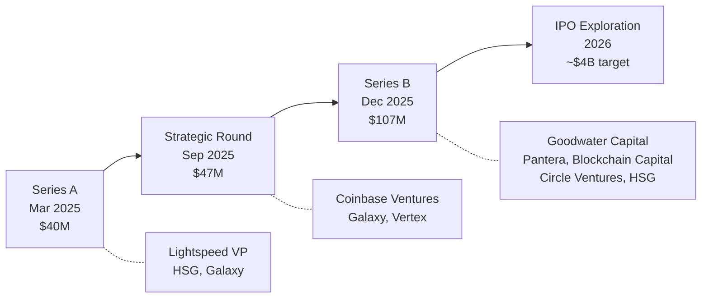
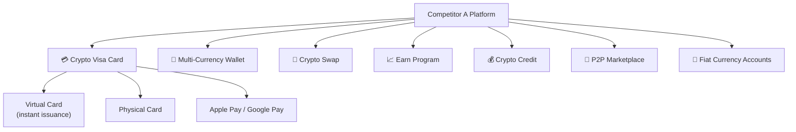
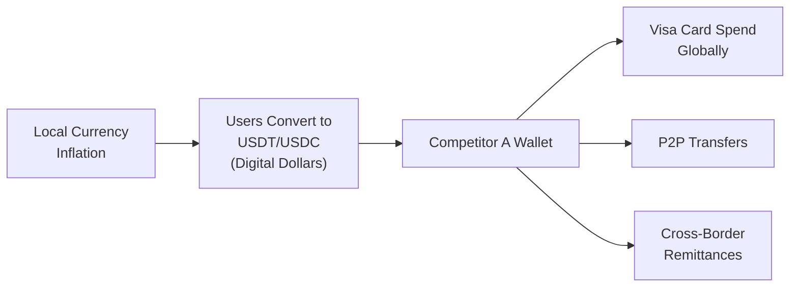
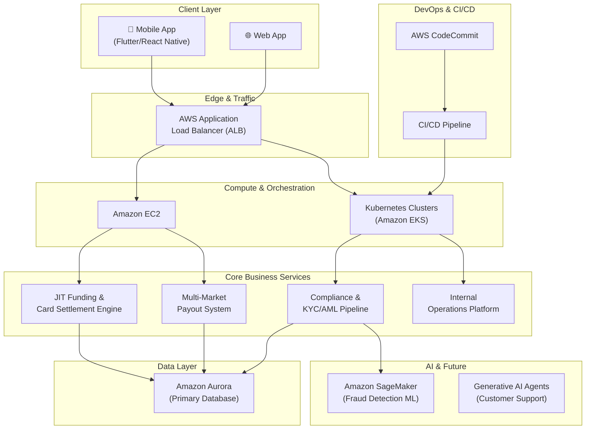
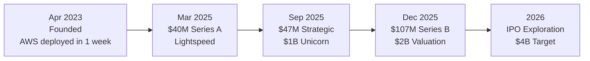

# Competitor A — Full Strategy & AWS Case Study Report

**Prepared for:** Ashutosh Kumar Singh, Founder & CEO, FurlPay  
**Purpose:** Reference case study for AWS partnership discussions with Cyrus Fang  
**Date:** October 15, 2026

---

## Table of Contents

1. [Company Overview](#1-company-overview)
2. [Leadership Team](#2-leadership-team)
3. [Funding History & Valuation](#3-funding-history--valuation)
4. [Product Suite](#4-product-suite)
5. [Go-to-Market Strategy](#5-go-to-market-strategy)
6. [AWS Infrastructure Deep Dive](#6-aws-infrastructure-deep-dive)
7. [Regulatory & Compliance Framework](#7-regulatory--compliance-framework)
8. [Competitive Landscape](#8-competitive-landscape)
9. [Key Metrics & Milestones](#9-key-metrics--milestones)
10. [Lessons & Parallels for FurlPay](#10-lessons--parallels-for-furlpay)

---

## 1. Company Overview

| Detail | Information |
|---|---|
| **Company** | Competitor A |
| **Legal Entity** | Red F. Technology Limited |
| **Founded** | April 2023 |
| **HQ** | Hong Kong |
| **Industry** | Crypto-fintech / Stablecoin Payments |
| **Users** | 6+ million verified users |
| **Countries** | 100+ countries |
| **Website** | [Competitor A.com](https://Competitor A.com) |
| **Valuation** | ~$2 billion (Dec 2025); exploring $4B IPO |
| **Total Raised** | $194 million |

### What Competitor A Does

Competitor A bridges **decentralized digital assets (stablecoins) with traditional financial rails**. In simple terms: users load USDT/USDC into their Competitor A wallet, get a Visa card, and spend crypto anywhere Visa is accepted — at 130M+ merchants globally. The conversion from crypto to fiat happens **in real-time at the point of sale**.

> [!IMPORTANT]
> Competitor A is the **closest operational parallel to FurlPay** in the AWS ecosystem. Both companies sit at the intersection of crypto payments, stablecoin infrastructure, and traditional finance rails. This is the case study to reference when speaking with Cyrus Fang.

---

## 2. Leadership Team

| Person | Role | Background |
|---|---|---|
| **Michael Gao** | Co-Founder & CEO | Former VP of Institutional Banking at DBS Bank |
| **Jonathan Chan** | Co-Founder & Head of Partnerships | Institutional relationships, payment corridors, ecosystem expansion |

### Key Insight
Michael Gao's **traditional banking background** (DBS is one of Southeast Asia's largest banks) gave Competitor A instant credibility with card networks, regulators, and institutional investors. The TradFi-to-crypto founder archetype is powerful for compliance-first companies.

---

## 3. Funding History & Valuation

### Funding Rounds

| Round | Date | Amount | Lead Investor | Valuation |
|---|---|---|---|---|
| **Series A** | March 2025 | $40M | Lightspeed Venture Partners | — |
| **Strategic** | September 2025 | $47M | Coinbase Ventures | **$1B** (Unicorn) |
| **Series B** | December 2025 | $107M | Goodwater Capital | **$2B** |
| **IPO (exploring)** | 2026 | ~$1B target raise | JPMorgan, Goldman Sachs, Jefferies (underwriters) | **$4B** target |
| **Total Raised** | | **$194M** | | |

### Full Investor List

| Investor | Type | Rounds |
|---|---|---|
| Lightspeed Venture Partners | Tier-1 VC | Series A (Lead) |
| Goodwater Capital | Growth VC | Series B (Lead) |
| Coinbase Ventures | Strategic/Crypto | Strategic (Lead) |
| Pantera Capital | Crypto Fund | Series B |
| Blockchain Capital | Crypto Fund | Series B |
| Circle Ventures | Strategic (USDC issuer) | Series B |
| HSG (formerly Sequoia China) | Tier-1 VC | Series A, B |
| Galaxy Ventures | Crypto Fund | Series A, Strategic |
| Vertex Ventures (Temasek-backed) | Southeast Asia VC | Strategic |

> [!TIP]
> **For the AWS call:** Competitor A's investor roster includes major AWS ecosystem players — Coinbase, Circle, and Lightspeed all have deep AWS relationships. Mentioning that FurlPay is building similar infrastructure should resonate.

---

## 4. Product Suite

### Core Products

| Product | Description |
|---|---|
| **Crypto Visa Card** | Virtual & physical Visa cards. Real-time crypto-to-fiat conversion at point of sale. Works at 130M+ merchants and ATMs worldwide. Supports Apple Pay & Google Pay. |
| **Multi-Currency Wallet** | All-in-one custodial wallet for stablecoins (USDT, USDC), BTC, ETH, SOL, BNB, XRP, TRX, TON, SUI |
| **Crypto Swap** | Instant internal conversion between cryptocurrencies and stablecoins |
| **Earn Program** | Deposit stablecoins to earn daily rewards/interest with flexible terms |
| **Crypto Credit** | Crypto-backed lending — borrow against BTC/ETH/SOL without selling |
| **P2P Marketplace** | Buy/sell stablecoins using 50+ local fiat currencies and 200+ payment methods |
| **Fiat Currency Accounts** | Direct EUR/GBP bank transfer onramps (jurisdiction-dependent) |

### Revenue Model

| Revenue Stream | Mechanism |
|---|---|
| **Interchange Fees** | Percentage from merchants via Visa network on each card swipe |
| **Conversion / FX Fees** | Spread on real-time crypto-to-fiat conversion at point of sale |
| **Transaction & Payout Fees** | Fees on P2P transfers, crypto withdrawals, cross-border payouts |
| **Lending Interest** | Interest margin on crypto-backed credit lines |
| **Earn Spread** | Spread between yield earned and yield paid to depositors |

---

## 5. Go-to-Market Strategy

### The Competitor A GTM Formula

> **Treat stablecoins as the settlement layer. Leverage Visa's 130M+ merchant network as the frontend. Target emerging markets where traditional banking fails.**

### Strategic Pillars

#### Pillar 1: Emerging Market Financial Inclusion

- **Target Markets:** Latin America, Africa, Middle East, Southeast Asia
- **Problem Solved:** High local inflation, weak banking infrastructure, limited USD access
- **Solution:** Stablecoins as digital dollars + Visa card for real-world spending
- Users in Argentina, Nigeria, and similar markets use Competitor A as their primary financial tool

#### Pillar 2: Zero-Friction Onboarding
- Fast KYC powered by AWS auto-scaling infrastructure
- Instant virtual card issuance (start spending in minutes, not days)
- Aggressive affiliate and referral programs for viral growth
- Localized marketing and 50+ local fiat currency support via P2P

#### Pillar 3: Card Network Leverage
- **Visa partnership** (via regional BIN sponsors like StraitsX in Singapore)
- Real-time Just-In-Time (JIT) funding — crypto-to-fiat conversion at the exact moment of purchase
- To the merchant: it's a normal Visa transaction
- To the user: it's spending crypto seamlessly

#### Pillar 4: Compliance as Competitive Moat
- Licenses in 5+ jurisdictions (see Section 7)
- ISO 27001 + PCI-DSS certified
- KYC/AML embedded at every touchpoint
- Institutional investors require this — creates a fundraising advantage

---

## 6. AWS Infrastructure Deep Dive

### Why Competitor A Chose AWS

Competitor A deployed its **entire infrastructure on AWS in just one week** at launch (April 2023). Three driving reasons:

1. **Data Security & Global Compliance** — Financial workloads require SOC/ISO/GDPR-ready infrastructure
2. **Global Scalability** — Multi-region deployment for low-latency international card settlements
3. **Comprehensive Service Suite** — Full-stack cloud for everything from app servers to ML fraud detection

### Architecture Overview

### AWS Services Used by Competitor A

| AWS Service | Use Case |
|---|---|
| **Application Load Balancer (ALB)** | Traffic routing, SSL termination, security filtering |
| **Amazon EC2** | App servers, card settlement logic, payout engines |
| **Amazon EKS (Kubernetes)** | Microservices orchestration, dynamic scaling |
| **Amazon Aurora** | Primary relational database for financial ledger, user data |
| **AWS CodeCommit** | Source code management and version control |
| **AWS CI/CD Pipeline** | Automated build, test, and deployment (twice-weekly releases) |
| **AWS Auto Scaling** | Handle traffic spikes during crypto market surges |
| **Amazon SageMaker** | ML-powered fraud detection (in development) |
| **Generative AI on AWS** | Automated customer support agents (in development) |

### DevOps & Deployment Metrics

| Metric | Value |
|---|---|
| **Initial AWS Deployment** | 1 week (April 2023) |
| **Production Deployments** | Twice weekly |
| **Automated Testing** | Daily |
| **Uptime** | Near-zero downtime |
| **Architecture** | Microservices-based |

> [!NOTE]
> **Key Takeaway for FurlPay:** Competitor A deployed on AWS in **1 week** and was processing real payments shortly after. This speed-to-market story resonates with AWS — it demonstrates the platform's startup-friendliness. FurlPay can tell a similar story.

---

## 7. Regulatory & Compliance Framework

### Global License Portfolio

| Jurisdiction | License Type | Regulator | Status |
|---|---|---|---|
| **Hong Kong** | MSO / TCSP / Money Lender | HK Customs & Excise | ✅ Active |
| **United States** | Money Services Business (MSB) | FinCEN | ✅ Active |
| **Canada** | Money Services Business (MSB) | FINTRAC | ✅ Active |
| **Argentina** | Virtual Asset Service Provider (VASP) | CNV | ✅ Active |
| **Mexico** | VASP / AML Registration | Mexican Financial Authorities | ✅ Active |

### Security Certifications

| Certification | Scope |
|---|---|
| **ISO/IEC 27001** | Information security management |
| **PCI-DSS** | Payment card data handling |
| **MPC Infrastructure** | Multi-party computation for asset protection |

### Compliance Stack

- KYC/AML: LexisNexis ThreatMetrix + Bridger Insight XG
- Sanctions Screening: Real-time checks
- Fraud Detection: ML-powered (Amazon SageMaker)
- Data Security: AWS-native security + MPC

---

## 8. Competitive Landscape

### Competitor A vs. Major Competitors

| Feature | Competitor A | Binance Card | Crypto.com Card |
|---|---|---|---|
| **Primary Focus** | Low-cost stablecoin spending | Exchange ecosystem utility | Tiered lifestyle perks |
| **Target Market** | Emerging markets, unbanked | Crypto traders | Crypto-native consumers |
| **Card Network** | Visa | Visa | Visa |
| **Conversion Fees** | ~0% on stablecoins | 0%–1% | Varies by tier |
| **Cashback** | Minimal / None | Up to 8% (tiered) | Up to 8% (CRO staking) |
| **Staking Required?** | ❌ No | Optional | ✅ Yes (for good perks) |
| **Primary Assets** | USDT, USDC | BTC, ETH, BNB + many | CRO, BTC, ETH + many |
| **Virtual Card** | ✅ Instant issuance | ✅ | ✅ |
| **P2P Marketplace** | ✅ 50+ fiat currencies | ✅ | ❌ |
| **Earn / Lending** | ✅ | ✅ | ✅ |
| **KYC Speed** | Fast / streamlined | Slow / extensive | Slow / extensive |
| **Regulatory Licenses** | 5+ jurisdictions | Complex / jurisdiction-dependent | Multiple licenses |

### Competitor A's Competitive Advantages

1. **Near-zero stablecoin spending fees** — no conversion penalty for USDT/USDC
2. **Speed of onboarding** — virtual card in minutes vs. days on exchanges
3. **Emerging market focus** — where demand for "digital dollars" is strongest
4. **No staking requirements** — unlike Crypto.com/Binance cards
5. **Compliance-first** — institutional-grade from day one
6. **AWS-native** — scalable infrastructure handling millions of users

---

## 9. Key Metrics & Milestones

### Growth Timeline

### Key Numbers

| Metric | Value |
|---|---|
| **Total Users** | 6+ million verified |
| **Countries** | 100+ |
| **Total Funding** | $194 million |
| **Valuation** | ~$2 billion (Dec 2025) |
| **IPO Target** | ~$4 billion |
| **Annualized Revenue** | $150+ million |
| **Annualized Payment Volume** | $10+ billion |
| **Time to Deploy on AWS** | 1 week |
| **Production Deployments** | 2x per week |
| **Merchant Acceptance** | 130+ million (via Visa) |
| **Supported Fiat Currencies (P2P)** | 50+ |
| **Payment Methods (P2P)** | 200+ |

---

## 10. Lessons & Parallels for FurlPay

### What FurlPay Can Learn from Competitor A

| Competitor A Strategy | FurlPay Parallel | Action Item |
|---|---|---|
| Built on AWS from Day 1 | ✅ Already on Vercel/cloud | Articulate AWS migration/expansion plan to Cyrus |
| Compliance-first approach | ✅ Building with security rules | Highlight Zod validation, rate limiting, HMAC verification in pitch |
| Emerging market focus | 🟡 Travel payments are global | Position FurlPay as enabling **travel spending for emerging market users** |
| Stablecoin as settlement layer | ✅ Stablecoin payments core product | Emphasize USDC/USDT payment rails |
| Visa card integration | ✅ Virtual card issuing | Highlight card issuing as a key growth driver |
| Fast KYC onboarding | 🟡 Opportunity | Build AWS-powered KYC pipeline |
| AI for fraud detection | ✅ AI-powered platform | Pitch Amazon Bedrock / SageMaker usage |
| JIT crypto-to-fiat conversion | ✅ Crypto-to-fiat payments | Core product alignment |

### Talking Points for the Cyrus Call

> [!IMPORTANT]
> **The Competitor A Pitch to Cyrus:**
> 
> *"Competitor A is one of AWS's biggest Web3 success stories — they deployed on AWS in one week, scaled to 6M users, and are now a $2B company heading for IPO. FurlPay is building at the same intersection — stablecoin payments, card issuing, and AI-powered finance — but with a unique travel vertical. We want to be the next Competitor A-scale story for AWS."*

### FurlPay's Unique Differentiators vs. Competitor A

| Differentiator | FurlPay | Competitor A |
|---|---|---|
| **Travel Integration** | ✅ Flights + Hotels + Crypto Payments | ❌ No travel vertical |
| **AI-Powered Intelligence** | ✅ Core product feature | 🟡 Exploring (SageMaker) |
| **On-chain Investment** | ✅ Investment infrastructure | ❌ Payments only |
| **Agentic Finance** | ✅ Building autonomous agents | ❌ Traditional app |

### AWS Services FurlPay Should Request Credits For

Based on Competitor A's architecture, these are the AWS services FurlPay should target:

| Service | FurlPay Use Case | Monthly Est. |
|---|---|---|
| **Amazon Bedrock** | AI-powered financial intelligence, agentic features | High |
| **Amazon EKS** | Microservices for payment processing | High |
| **Amazon Aurora** | Financial ledger, transaction database | Medium |
| **Amazon EC2** | Core app servers, settlement engine | High |
| **AWS Lambda** | Serverless payment webhooks, event processing | Medium |
| **Amazon S3** | Document storage, compliance data | Low |
| **AWS ALB** | Traffic management, SSL termination | Low |
| **Amazon SageMaker** | Fraud detection ML models | Medium |
| **AWS CodePipeline** | CI/CD automation | Low |

---

## Appendix: Source Links

| Source | URL |
|---|---|
| AWS Case Study | [aws.amazon.com/solutions/case-studies/Competitor A](https://aws.amazon.com/solutions/case-studies/Competitor A) |
| Competitor A Official | [Competitor A.com](https://Competitor A.com) |
| Series B Announcement | [Competitor A.com/blog](https://Competitor A.com) |
| LexisNexis Partnership | [lexisnexis.com](https://risk.lexisnexis.com) |

---

*Report compiled on October 15, 2026. All data sourced from AWS case studies, Competitor A official announcements, investor press releases, and public financial reporting.*
